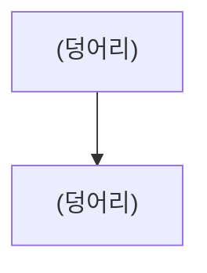
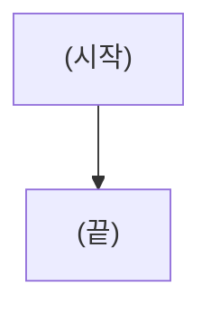
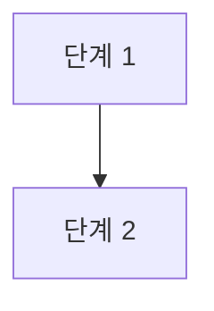

# 아키텍처

상태: 작성 중  
확인: 쓴 사람 (이름, 날짜) · 승인 (승인한 사람, 날짜)  
팀 검토 사본: 없음

> 여러 탭이 같이 쓰는 것(덩어리와 연결, 함께 쓰는 정보, 제품 AI 판단 흐름, 큰 기술 선택)을 정한 문서입니다. 요건은 `docs/requirements/`에 있습니다.  
> 스펙과 구현 계획은 여기서 정한 것을 다시 정하지 않습니다. 확정 전에도 초안은 쓸 수 있지만, 확정은 이 문서가 확정된 뒤에 합니다.  
> 고쳐야 하면 아키텍처로 되돌려 보냅니다.

## 읽은 것

| 문서 | 읽은 때의 상태 | 읽은 때의 커밋 |
|---|---|---|
| [requirements.md](../requirements/requirements.md) | (작성 중, 확인 대기, 확정 날짜 중 하나) | |
| [01-(탭 이름).md](../requirements/tabs/01-(탭 이름).md) | | |
| [scope.md](../requirements/scope.md) 「다른 단계로 넘길 것」 | | |

참고한 자료 (`scope.md` 참고 자료 목록 가운데 실제로 읽은 것)

| 자료 | 본 대목 | 읽은 날 |
|---|---|---|

## 1. 한눈에 보기

(이 장이 정한 것, 두세 줄)

### 덩어리와 연결

### 전체 흐름

(일 한 건이 처음부터 끝까지 가는 흐름. 자세한 단계는 3장)

| 덩어리 | 하는 일 | 근거 |
|---|---|---|
| (화면, 서버, AI 판단, 저장소, 알림 등) | | (요건 번호) |

## 2. 함께 쓰는 정보

(이 장이 정한 것, 두세 줄)

### (정보 이름)

(무엇을 담는 정보인지 한 줄)

| 항목 | 뜻 | 값 | 근거 |
|---|---|---|---|
| | | (정해진 값이 있을 때만, 예: 접수, 처리 중, 완료) | (요건 번호) |

## 3. AI 판단 흐름

(이 장이 정한 것, 두세 줄)

| 단계 | 하는 일 | 받는 것 | 넘기는 것 | 누가 하나 | 근거 |
|---|---|---|---|---|---|
| 단계 1 | | | | (제품 AI, 시스템, 사람 중 하나) | (요건 번호) |

## 4. 기술 선택

(이 장이 정한 것, 두세 줄. 큰 선택만 씁니다.)

| 무엇 | 고른 것 | 고르지 않은 안 | 이유 | 넘겨받은 곳 |
|---|---|---|---|---|
| (LLM, 임베딩, DB, 에이전트 프레임워크, 앱 언어와 프레임워크 등) | (기술 이름: 무엇을 하는 것인지 한 줄) | | | (scope.md 대목이나 요건 번호) |

기술 스택 ADR: (없음, 또는 ADR 링크. 이 장이 원본입니다.)

## 5. 실패와 예외

(이 장이 정한 것, 두세 줄)

| 상황 | 어떻게 하나 | 근거 |
|---|---|---|

## 6. 비밀과 시험 자료

| 무엇 | 어디에 두나 | 지킬 것 |
|---|---|---|
| API 키 | `.env` | git에 올리지 않습니다. 각자 개인 키를 씁니다. |
| 시험 자료 | | 모두 가상으로 만듭니다. |

## 7. 탭별로 보기

요건의 탭 목록과 같은 번호입니다. 본문에 없는 것을 여기서 새로 정하지 않습니다.

| 탭 | 쓰는 정보 | 흐름에서 맡는 단계 | 근거 요건 |
|---|---|---|---|
| 1. (탭 이름) | (2장의 정보 이름) | (3장의 단계 번호) | (요건 번호) |

## 정한 것

| # | 질문 | 고른 답 | 고르지 않은 안 | 이유 |
|---|---|---|---|---|

## 질문 대기

| # | 질문 | 추천 답 | 다른 안 | 근거 (자료와 대목) |
|---|---|---|---|---|
| 1 | (아직 답하지 않은 질문) | (근거가 없으면 "추천 없음") | | |

## 다른 단계로 넘길 것

| 질문 | 넘길 단계 | 나온 곳 |
|---|---|---|
| (아키텍처에서 정하지 않을 것) | (요건정리, 디자인, 스펙, 구현 계획 중 하나) | (장 번호) |
