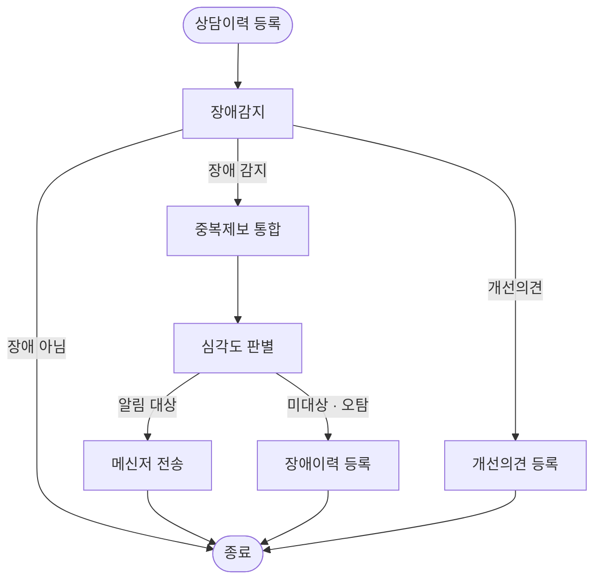
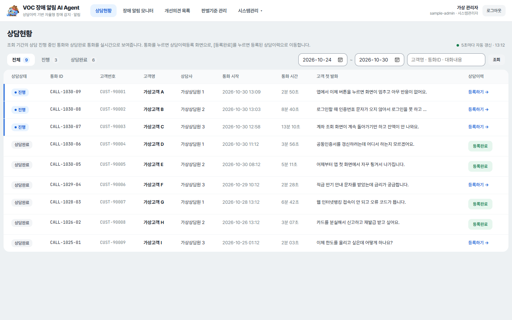
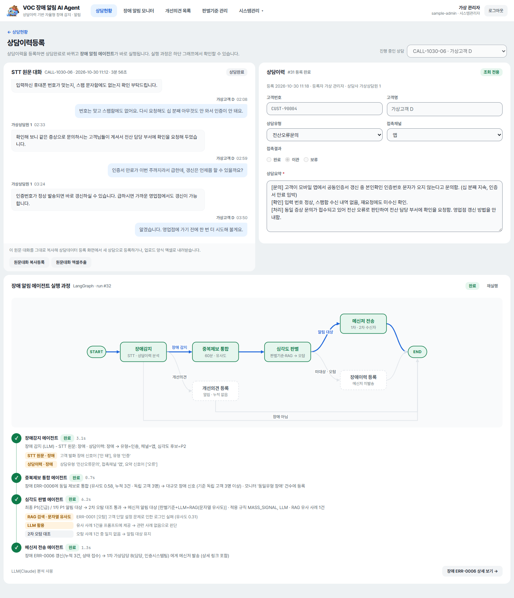
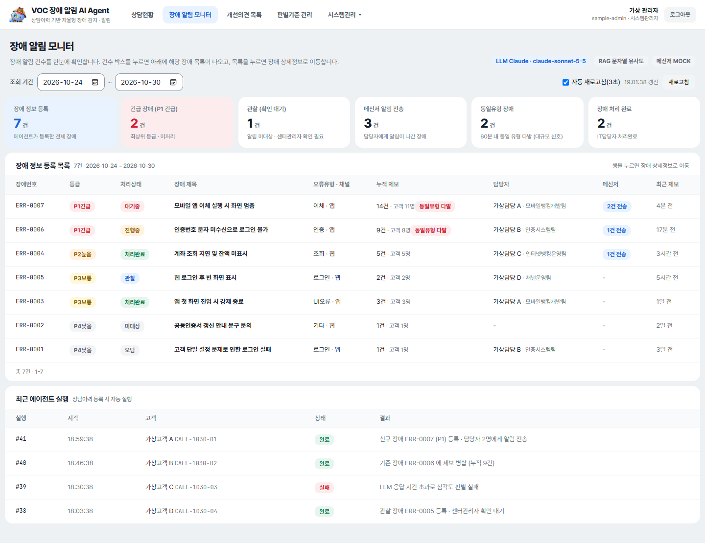
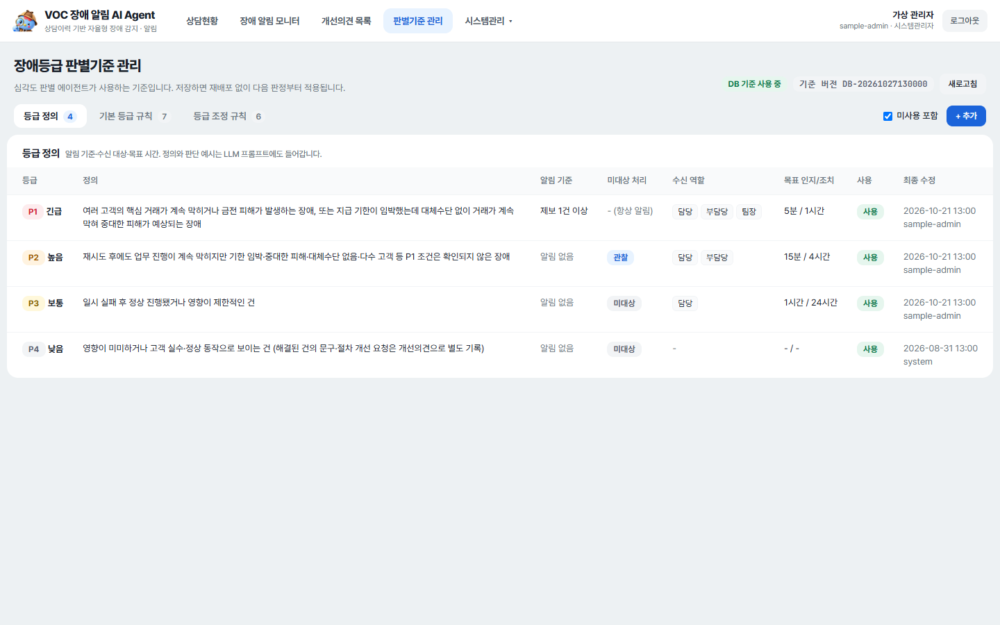
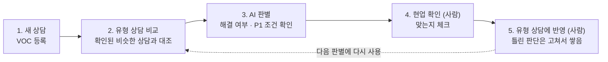

# 콜록 홈즈 — VOC 기반 자율형 장애 알림 AI Agent

2026년 하반기 JB금융그룹 AI 경진대회 출품작입니다.

상담이 끝난 상담 이력을 AI 에이전트가 읽고, 웹·앱 장애가 있는지 찾아냅니다.  
장애로 판단하면 등급을 매기고, 내용을 정리해 IT 담당자에게 바로 알립니다.  
고객의 작은 '콜록'(불편) 하나로 장애의 병명을 추리하고, 번지기 전에 처방하자는 뜻으로 팀 이름을 지었습니다.

## 한눈에 보기

| 무엇 | 내용 |
|---|---|
| 하는 일 | 상담 이력 → 장애 감지 → 중복 제보 통합 → 심각도 판별 → 담당자 식별·알림 (P1은 자동 알림, P2는 관찰 뒤 센터관리자가 수동 알림) |
| 에이전트 | LangGraph `StateGraph` (노드 6개, 한 번에 최대 4단계, `backend/app/agents/graph.py`), 판별 근거와 과거 사례(RAG)를 함께 보여 줌 |
| AI 모델 | Claude API(`claude-sonnet-5-5`), 실패하면 규칙 기반으로 자동 대체 |
| 기술 | FastAPI · Vue 3 · PostgreSQL · axhub(Docker 단일 이미지) |
| 화면 | 상담현황 · 상담이력등록 · 장애 알림 모니터 · 장애 상세정보 · 개선의견 · 판별기준 관리 · 사용자·인사정보·고객정보 관리 · 상담데이터 등록 |

## 에이전트 구성

### 서비스 안에서 도는 AI 에이전트

상담이력을 등록하면 LangGraph가 아래 순서로 에이전트를 실행합니다. 한 번에 최대 4단계를 지나고, 단계마다 결과와 근거가 화면에 남습니다.



| 에이전트 | 하는 일 | AI(Claude) | AI를 못 쓸 때 | 파일 |
|---|---|---|---|---|
| 장애감지 | STT 원문과 상담이력을 읽어 장애 / 개선의견 / 일반으로 나누고 오류유형, 채널, 증상, 환경을 정리합니다. 팀이 확인한 유형 상담, 상담사가 그 자리에서 해결했는지, P1 관계 지도를 함께 보고, AI가 인용한 말이 실제 대화에 있는지도 확인합니다 | 씀 | 키워드 규칙으로 판정 | `backend/app/agents/detection.py`, `p1_flow.py` |
| 중복제보 통합 | 최근 60분 안의 같은 유형 미해결 장애와 비교해 하나로 묶고, 서로 다른 고객이 기준(기본 3명) 이상이면 대규모 장애 신호로 봅니다 | 안 씀 | - | `dedup.py` |
| 심각도 판별 | 판별기준(DB)으로 P1~P4를 정하고, 과거 해결·오탐 사례(RAG)를 참고하고, 알림 대상이면 과거 오탐과 한 번 더 대조합니다. 근거를 모두 남깁니다 | 씀 | 판별기준과 규칙으로 판정 | `severity.py` |
| 메신저 전송 | 담당 IT담당자(1차)와 비슷한 과거 장애를 처리한 사람(2차)을 찾아 상세 링크와 과거 해결 사례를 담아 보냅니다 | 안 씀 | - | `notify.py` |
| 장애이력 등록 | 알림 대상이 아니면 메신저 없이 장애만 등록합니다(관찰 / 미대상 / 오탐) | 안 씀 | - | `notify.py` |
| 개선의견 등록 | 해결된 건의 문구·절차 개선 요청을 알림 없이 기록하고 관련 장애에 연결합니다 | 안 씀 | - | `improve.py` |

그래프 밖에서 AI를 쓰는 곳이 하나 더 있습니다. 상담요약 초안(`summary.py`)이 STT 원문을 상담사 관점의 `[문의]` `[확인]` `[처리]` 3줄로 요약합니다.
자세한 동작은 [아키텍처 3장](docs/architecture/architecture.md#3-에이전트-흐름-langgraph)에 있습니다.

### 개발에 쓴 에이전트 (SDD)

요건과 설계 문서를 만들 때 쓴 도구이며, 위의 서비스 안 에이전트와는 다릅니다. 10개를 정했고 4개를 만들었습니다([SDD 한눈에 보기](docs/guide/sdd.md)).

| 에이전트 | 부르는 법 | 하는 일 | 남기는 것 | 만들었나 |
|---|---|---|---|---|
| 인터뷰 | `/sdd-interviewer` | 범위와 큰 갈림길을 정합니다 | `docs/requirements/scope.md` | 있음 |
| 요건정리 | `/sdd-analyst` | 화면 탭별로 요건을 자세히 씁니다 | `docs/requirements/requirements.md`, `tabs/` | 있음 |
| 아키텍처 | `/sdd-architect` | 여러 탭이 같이 쓰는 것을 한곳에서 정합니다 | `docs/architecture/architecture.md` | 있음 |
| 디자인 | `/sdd-designer` | 화면 규칙을 정하고 탭마다 시안을 만듭니다 | `docs/design/style-guide.md` | 있음 |
| 스펙, 구현 계획, 백엔드 구현, 프론트 구현, 코드 리뷰, QA | - | 정했지만 만들지 않았습니다(이유는 [ADR-009](docs/adr/ADR-009-build-without-spec-agents.md)) | - | 아직 |

## 화면

시연용 가상 데이터로 찍은 화면입니다. 나머지 화면은 [docs/design/screens](docs/design/screens/)에 있습니다.

**상담현황** — 열 머리글을 눌러 정렬하고, 목록은 15건씩 나눠 봅니다.



**상담이력등록 — 에이전트 실행 과정** — 등록하면 단계별 진행과 근거가 보이고, 끝나면 판별 결과 팝업이 열립니다.



**장애 알림 모니터**



**판별기준 관리** — 등급 정의, 기본 등급 규칙, 등급 조정 규칙을 고치면 다음 판단부터 바로 적용됩니다.



## 판단 방식

- **근거를 모두 보여 줍니다.** 상담이력을 등록하면 「장애 판별 결과」 팝업이 열려 등급, 알림을 보냈는지와 이후 처리, 판단 근거(감지 판정, 같은 증상 제보 수, 적용한 규칙, 과거 유사 사례, 오탐 대조)를 보여 줍니다. 단계별 결과는 실행 과정에도 남습니다.
- **기준은 화면에서 바꿉니다.** 판별기준 관리에서 등급 정의와 규칙을 고치면 재배포 없이 5초 안에 다음 판단부터 적용되고, 어떤 기준 버전으로 판단했는지가 장애에 기록됩니다.
- **과거를 참고합니다.** 처리가 끝난 장애와 오탐으로 확인된 장애를 다음 판단의 과거 사례로 쓰고, 알림 대상이면 과거 오탐과 한 번 더 대조합니다.
- **AI가 실패해도 멈추지 않습니다.** Claude 호출이 실패하거나 키가 없으면 규칙 기반 판정으로 이어 갑니다.
- **장애 감지를 보강했습니다.** 팀이 확인한 유형 상담 38개와 P1 관계 지도를 AI에 함께 주고, 상담사가 통화 중 해결한 건은 P1에서 빼며, AI가 인용한 말이 실제 대화에 없으면 그 판단을 쓰지 않고 「확인 필요」로 표시합니다. 이 자료 2개는 현업 확인을 반영한 초안입니다([아키텍처 3.3](docs/architecture/architecture.md#33-노드별-정리)). 이 보강은 아래 「상담 검증 프로세스」의 앞 세 단계입니다.

## 상담 검증 프로세스

장애 감지 보강은 팀이 정한 「상담 검증 프로세스」를 코드로 옮긴 것입니다. 현업이 확인한 상담을 기준으로 삼아 새 상담을 대조하고, 틀린 판단은 사람이 고쳐 다음 판단에 쓰는 구조입니다.



| 단계 | 하는 일 | VocAi에서는 |
|---|---|---|
| 처음 한 번 준비 | 과거 상담 유형을 현업이 확인해 유형 상담으로 씁니다 | 유형 40개를 확인했고, 잘못된 예제 2개를 뺀 38개를 `backend/app/data/type_cases.json`에 넣었습니다 |
| 1. 새 상담 | 상담이력을 등록합니다 | 구현. 상담이력등록 화면 |
| 2. 유형 상담 비교 | 확인된 비슷한 상담과 대조합니다 | 구현. 새 상담과 비슷한 순서로 유형 상담을 정렬해 AI에 줍니다(LLM을 쓸 때) |
| 3. AI 판별 | 상담사가 해결했는지, P1 조건에 맞는지 확인합니다 | 구현. 상담사 해결 판단, P1 관계 지도(`p1_graph.json`), AI가 인용한 말이 실제 대화에 있는지 확인 |
| 4. 현업 확인 | AI 판단이 맞는지 사람이 봅니다 | 사람이 하는 단계입니다. 확인용 화면은 없습니다 |
| 5. 유형 상담에 반영 | 틀린 판단은 고쳐서 쌓습니다 | 사람이 `type_cases.json`을 고쳐 다시 배포하는 방식입니다. 화면이나 자동 반영은 없습니다(향후 과제, 요건 4-08) |

그래서 「쌓일수록 고도화」는 4~5단계를 사람이 계속 돌려야 일어납니다. 프로그램이 스스로 학습하지는 않고, 이 순환으로 판별 정확도가 좋아졌다는 측정 결과도 아직 없습니다.
처리가 끝난 장애와 오탐을 다음 판단의 과거 사례로 쓰는 일(RAG)은 자동으로 일어납니다. 자세한 동작은 [아키텍처 3.3](docs/architecture/architecture.md#33-노드별-정리)에 있습니다.

## 일하는 방식

> Stop praying, start planning. (기도 금지, 설계 시작)

팀은 AI에게 결과만 바라고 기다리지 않고, 요건과 설계를 사람이 먼저 정한 뒤 AI가 돕게 하는 방식(SDD)을 정했습니다.  
이 저장소의 앱 코드(`backend/`, `frontend/`)는 개발 담당이 따로 만들었고, 이 문서대로 만든 것은 아닙니다. 개발 에이전트 4개(인터뷰, 요건정리, 아키텍처, 디자인)는 요건과 설계 문서를 만드는 데 썼습니다. 제출 코드는 이 요건에 대조해 검증했습니다. [요건 대비 구현 현황](docs/requirements/vocai-status.md)은 요건 93개마다 구현 여부와 근거 파일을 추적한 표로, SDD 흐름의 검증 단계 산출물입니다. 코드에 없는 요건은 지우지 않고 향후 과제로 나눴습니다([ADR-011](docs/adr/ADR-011-future-work-scope.md)). 이렇게 된 사정은 [ADR-010](docs/adr/ADR-010-submission-implementation.md)에 있습니다.  
흐름과 개발 에이전트는 [SDD 한눈에 보기](docs/guide/sdd.md)에, 왜 그렇게 정했는지는 [ADR-002](docs/adr/ADR-002-dev-flow-and-agents.md)에 있습니다.

## 알려진 한계와 향후 과제

- 장애 감지 보강에 쓰는 자료(유형 상담, P1 관계 지도)는 「초안 — 팀 확인 전」입니다. 확정된 기준이 아닙니다.
- 자동 테스트 코드와 CI가 없습니다.
- 요건의 성과측정 화면은 없고, 상담사관리자의 승인 흐름은 「관찰 → 센터관리자 수동 알림」으로 바꿔 구현했습니다. 요건별 구현 여부와 향후 과제는 [요건 대비 구현 현황](docs/requirements/vocai-status.md)에 있습니다.
- 시연용 노드 간 지연(`AGENT_STEP_DELAY_SEC`)이 기본으로 켜져 있어 에이전트 실행이 실제보다 느리게 보입니다. 시연 데이터는 모두 가상입니다.
- 그 밖의 한계와 주의는 [아키텍처 11장](docs/architecture/architecture.md#11-알려진-한계와-주의)에 있습니다.

## 폴더 구조

```
VocAi/
├── backend/         FastAPI 서버, LangGraph 에이전트, DB 스크립트 (sql/, scripts/)
├── frontend/        Vue 3 + Vite 화면
├── Dockerfile       axhub 배포용 단일 이미지 (Vue 빌드 결과를 backend/static 으로 묶음)
├── axhub.yaml       axhub 앱 설정
├── deploy.ps1       GCP Cloud Run 배포 스크립트
│
├── CLAUDE.md        Claude Code가 세션을 열 때 가장 먼저 읽는 파일
├── .claude/         개발 에이전트 (skills/), 에이전트 사이의 약속 (rules/)
├── harness/         Claude가 매번 지킬 규칙
└── docs/            개발 문서
    ├── adr/             결정 기록. 무엇을 왜 그렇게 정했는지, 다른 안은 무엇이었는지
    ├── requirements/    범위와 요건정의서, 요건 대비 구현 현황
    ├── architecture/    아키텍처. 에이전트 흐름, 데이터, API, 권한, 설정값
    ├── deploy/          배포와 운영
    ├── design/          화면 규칙, 화면 캡처 (가상 데이터)
    └── guide/           SDD 한눈에 보기
```

## 문서 지도

| 알고 싶은 것 | 문서 |
|---|---|
| 개발 문서 전체와 읽는 순서 | [docs/README.md](docs/README.md) |
| 시스템이 어떻게 생겼나 | [아키텍처](docs/architecture/architecture.md) |
| 화면 모양의 규칙과 캡처 | [화면 규칙](docs/design/style-guide.md) |
| 무엇을 만들기로 했나 | [범위](docs/requirements/scope.md) · [요건정의서](docs/requirements/requirements.md) |
| 요건 중 무엇이 구현됐나 | [요건 대비 구현 현황](docs/requirements/vocai-status.md) |
| 왜 이렇게 정했나 | [결정 기록](docs/adr/README.md) |
| 개발 흐름과 개발 에이전트 | [SDD 한눈에 보기](docs/guide/sdd.md) |
| 배포하고 운영하는 법 | [배포와 운영](docs/deploy/deploy.md) |

아래는 실행 가이드입니다. 로컬에서 돌리는 순서, 설정값, 시연 시나리오, 화면별 기능이 단계별로 적혀 있습니다. 개발하면서 단계별로 덧붙인 글이라 파일 개수 같은 일부 설명은 지금과 다를 수 있으며, 현재 구성은 [아키텍처](docs/architecture/architecture.md)가 기준입니다.

---

## 실행 가이드

```
backend/     FastAPI (Cloud Run 배포 대상, 배포 시 frontend 빌드 결과가 backend/static 으로 복사됨)
frontend/    Vue 3 + Vite
deploy.ps1   Vue 빌드 → backend/static 복사 → Cloud Run 배포
```

### 0. 구성 요약
- **에이전트 오케스트레이션**: LangGraph `StateGraph` (`app/agents/graph.py`)
  - 노드: 장애감지 → 중복제보 통합 → 심각도 판별 → (분기) 담당자식별·알림 / 장애이력 등록
  - 조건 분기: 장애감지 후 `장애 아님 → END`·`개선의견 → 개선의견 등록`, 심각도 판별 후 `알림 대상 → 알림`, `관찰·오탐 → 이력 등록`
- **LLM**: Claude API (`claude-sonnet-5-5`) - 장애감지, 심각도 판별 노드에서 사용. 실패 시 규칙 기반으로 자동 대체
- **RAG**: 심각도 판별 시 과거 해결·오탐 장애를 검색해 LLM 프롬프트에 넣고, 등급·초기 분석(추정 원인·점검 포인트)·2차 오탐 대조·메신저 과거 해결 사례에 사용. 검색 방식은 `RAG_SEARCH`: 기본 `text`(문자열 유사도, 배포 환경용) / `embedding`(로컬 Ollama `bge-m3` + PostgreSQL **pgvector**, pgvector 미설치 시 `real[]`, 임베딩 서버 미연결 시 문자열 유사도로 대체)

### 1. 추가된 파일

#### 백엔드 (backend/)
| 파일 | 내용 |
|---|---|
| `sql/01_schema.sql` | 테이블 정의 (STT, 상담이력, 업무담당자, 장애알림, 제보연결, 메신저이력, 에이전트 실행로그) |
| `sql/02_seed.sql` | 시연용 데이터 (STT 통화 10건 = P1 발송 대상 3건 + 일반 상담 7건, 담당자 12명, 과거 장애/오탐 이력 5건) |
| `scripts/init_db.py` | 위 SQL 실행 스크립트 |
| `app/routers/voc_api.py` | API 5종 + 에이전트 실행/모니터 API |
| `app/services/repo.py` | DB 조회/등록 함수 (API와 에이전트가 공유) |
| `app/services/messenger.py` | 메신저 전송 (MOCK · 웹훅 · 텔레그램) |
| `app/agents/detection.py` | ① 장애감지 에이전트 |
| `app/agents/dedup.py` | ② 중복 제보 통합 에이전트 |
| `app/agents/severity.py` | ③ 장애 심각도 판별 에이전트 (규칙 + 과거이력 RAG) |
| `app/agents/notify.py` | ④ 담당자식별 및 알림 에이전트 |
| `app/agents/graph.py` | **LangGraph 그래프 정의** (노드/조건분기, mermaid 출력) |
| `app/agents/pipeline.py` | 그래프 실행 + 실행 결과 기록 |
| `app/services/rag.py` | 임베딩 생성(Ollama) + pgvector 유사사례 검색 + 지식베이스 갱신 |
| `app/agents/rules.py` | 키워드/심각도/알림 규칙 (여기서 규칙 조정) |
| `app/agents/llm.py` | Claude Messages API 호출 (JSON 출력, Ollama도 선택 가능) |

수정: `main.py` (라우터 등록, CORS에 POST/PATCH 허용), `app/database.py` (에이전트 설정 항목 추가)

#### 프론트엔드 (frontend/)
| 파일 | 내용 |
|---|---|
| `src/views/SttListView.vue` | STT 대화목록 |
| `src/views/ConsultRegisterView.vue` | 상담이력 등록 (등록 시 에이전트 진행상황 실시간 표시) |
| `src/views/IncidentMonitorView.vue` | 장애 알림 모니터 (3초 자동 갱신) |
| `src/views/CriteriaView.vue` | 장애등급 판별기준 관리 (등급 정의 / 기본 등급 규칙 / 조정 규칙 조회·등록·수정) |
| `src/views/ApiTestView.vue` | 기존 FastAPI 연동 테스트 화면 |
| `src/components/voc/AgentGraph.vue` | **LangGraph 흐름도** (실행 경로 하이라이트) |
| `src/components/voc/*` | 대화 말풍선, 에이전트 타임라인, 심각도/상태 배지 |
| `src/api/vocApi.js` | API 호출 함수 |
| `src/composables/useHashRoute.js`, `usePolling.js` | 화면 전환(해시), 주기 갱신 |
| `src/assets/voc.css` | 공통 스타일 |

수정: `App.vue` (상단 메뉴), `main.js` (voc.css 사용), `index.html` (제목). 새 npm 패키지 설치는 필요 없습니다.

### 2. 사전 준비 (최초 1회)

```powershell
# 1) 가상환경 + 패키지
cd backend
python -m venv venv
.\venv\Scripts\Activate.ps1
pip install -r requirements.txt
cp .env.example .env                 # 값 채우기

cd ..\frontend
npm install

# 2) 로컬 Ollama 설치 (https://ollama.com/download) 후 임베딩 모델 받기
ollama pull bge-m3
```

**pgvector (선택, 권장)**: 로컬 PostgreSQL에 pgvector가 없으면 자동으로 배열 방식으로 동작합니다.
pgvector로 시연하려면 아래 중 하나를 사용하세요.
- Docker: `docker run -d --name pgvector -p 5434:5432 -e POSTGRES_PASSWORD=비밀번호 pgvector/pgvector:pg16` 후 `.env`의 DATABASE_URL 포트 변경
- Windows 설치형 PostgreSQL: pgvector 공식 README의 Windows 빌드 안내(Visual Studio `nmake`) 참고
- Cloud SQL(배포 환경): 기본 지원 → `init_db.py`가 `CREATE EXTENSION vector` 자동 실행

pgvector를 나중에 설치했다면 `python scripts\init_db.py --reset`으로 다시 만들어야 vector 컬럼으로 바뀝니다.

### 3. 실행 순서

```powershell
cd backend
.\venv\Scripts\Activate.ps1
python scripts\init_db.py            # 테이블 + 시드 + 과거이력 임베딩 (DB 전체 초기화: --reset, 계정만 초기화: --reset-users)
uvicorn main:app --reload --port 8000

cd frontend
npm run dev                          # http://localhost:5173
```

`init_db.py` 출력에서 `incident_embedding 테이블 (pgvector)` 또는 `(array)`로 어떤 방식인지 확인할 수 있습니다.

### 3-1. .env 항목

```
ANTHROPIC_API_KEY=...                    # Claude API 키 (console.anthropic.com 에서 발급)
# 이하 선택 (기본값 있음)
LLM_PROVIDER=anthropic                   # anthropic / ollama / none(규칙 기반)
LLM_MODEL=claude-sonnet-5-5              # 비용을 줄이려면 claude-haiku-5-5
LLM_EFFORT=low                           # low / medium / high (생각 깊이)
RAG_SEARCH=text                          # text(문자열 유사도) / embedding(Ollama 임베딩 + pgvector)
RAG_IN_LLM=true                          # 검색한 과거 사례를 심각도 판별 LLM 프롬프트에 넣을지 여부
OLLAMA_EMBED_BASE_URL=http://localhost:11434   # 이하 RAG_SEARCH=embedding 일 때만 사용
OLLAMA_EMBED_MODEL=bge-m3
RAG_MIN_SIMILARITY=0.45                  # 유사 사례로 표시할 최소 코사인 유사도
RAG_FP_SIMILARITY=0.60                   # 과거 오탐 사례와 같은 건으로 볼 유사도
MESSENGER_PROVIDER=telegram              # mock / webhook / telegram (비우면 웹훅 URL 유무로 자동)
TELEGRAM_BOT_TOKEN=...                   # 텔레그램 봇 토큰. 인사정보 메신저 ID = chat_id
MESSENGER_WEBHOOK_URL=                   # MESSENGER_PROVIDER=webhook 일 때
DEDUP_WINDOW_MIN=60
MASS_SIGNAL_THRESHOLD=3
AGENT_STEP_DELAY_SEC=1.0                 # 시연용 노드 간 지연(초)
```

모니터 화면 상단 배지에서 `LLM Claude · claude-sonnet-5-5`, `RAG 문자열 유사도`(또는 `RAG pgvector · bge-m3`) 상태를 확인할 수 있습니다.
문자열 유사도 방식의 기준값(사례 0.1 이상 상위 3건, 오탐 일치 0.25)은 `app/agents/severity.py`에 있습니다.
임베딩 유사도 기준값은 bge-m3 기준 추정값이므로 시연 데이터로 결과를 보고 조정하세요.

### 4. 시연 시나리오 (시드 데이터 기준)

장애 알림(메신저 발송)은 **P1 등급만** 대상입니다. P2는 '관찰', P3·P4는 '미대상'으로 장애알림 정보에만 등록되고, 추가 제보로 P1이 되면 그때 알림이 나갑니다.
상담현황의 시드 통화(`02_seed.sql`)는 아래 3건입니다. 등급별 시연 통화(`DEMO-*`)는 `11_demo_scripts.sql`에 있습니다.

| 순서 | 통화 | 예상 결과 |
|---|---|---|
| 1 | CALL-0001 타행이체 출금 후 미입금 | 이체 P2 + 금전 피해 신호 → **P1**, 지급결제팀 알림 (2차: 과거 유사 장애 처리자) |
| 2 | CALL-0006 공동인증서 인증 모듈 오류(회사 직원 전부 안 됨) | 인증 **P2** → 관찰 등록 |
| 3 | CALL-0011 계약금 이체 불가(지급 기한 임박, 대체 수단 없음) | **P1**, 지급결제팀 알림 |

모니터 화면에서 장애를 선택해 "해결" 처리하고 원인/조치를 입력하면 즉시 임베딩되어(pgvector) 이후 유사 사례 검색에 사용됩니다.

### 5. API 목록 (/api 하위)

- STT원문조회: `GET /stt`, `GET /stt/{call_id}`
- 상담이력조회: `GET /consults`, `GET /consults/{id}` / 등록: `POST /consults`
- 업무담당자조회: `GET /owners?error_type=로그인`
- 장애알림정보등록: `POST /incidents` / 조회 `GET /incidents`, `GET /incidents/{id}` / 상태변경 `PATCH /incidents/{id}`
- 메신저전송: `POST /messenger/send` / 이력 `GET /messenger/logs`
- 에이전트 실행이력: `GET /agent-runs`, `GET /agent-runs/{id}`, 재실행 `POST /agent-runs`
- 모니터 요약: `GET /monitor/summary`
- LangGraph 구조: `GET /agent-graph` (발표 자료용 mermaid 텍스트 포함)

`.env`에 `ENABLE_DOCS=true`이면 http://127.0.0.1:8000/docs 에서 바로 테스트할 수 있습니다.

### 6. Cloud Run 배포 시 참고

에이전트는 상담이력 등록 응답 후 백그라운드에서 실행됩니다. Cloud Run 기본 설정(요청 처리 중에만 CPU 할당)에서는
백그라운드 처리가 느려질 수 있으므로, `deploy.ps1`의 `gcloud run deploy`에 `--no-cpu-throttling`이 들어 있습니다(과금 방식이 바뀌는 옵션입니다).
배포 전 Cloud SQL에도 `python scripts\init_db.py` 실행이 필요합니다.
Cloud Run에서는 PC의 로컬 Ollama(임베딩)에 접근할 수 없으므로, 배포 환경에서는 기본값 `RAG_SEARCH=text`(문자열 유사도)로 동작합니다. (임베딩 서버를 별도로 두면 `RAG_SEARCH=embedding`, `OLLAMA_EMBED_BASE_URL`로 지정)

### 7. 장애등급 판별기준 관리 (DB)

심각도 판별 에이전트는 등급 기준을 DB 테이블 3개에서 읽습니다. 테이블이 없거나 비어 있으면 `app/agents/rules.py`의 코드 기본값으로 동작합니다.

| 테이블 | 내용 |
|---|---|
| `severity_grade` | 등급 정의(P1~P4), 알림 최소 제보 건수, 수신 역할, 목표 시간, 메시지 머리말. 정의·판단 예시는 LLM 프롬프트에도 사용 |
| `severity_base_rule` | 오류유형·채널별 기본 등급 (채널 일치 규칙 우선) |
| `severity_adjust_rule` | 조정 규칙: KEYWORD(키워드 상향), REPORT_COUNT(제보 건수), MASS_SIGNAL(대규모 신호, 기준 건수는 중복통합에도 사용), FALSE_POSITIVE(오탐). `apply_order` 순서로 적용 |

- 생성: 로컬은 `python scripts\init_db.py`, Cloud SQL은 `sql/04_severity_criteria.sql` 실행 (기존 데이터 유지, 여러 번 실행 가능)
- 초기 데이터: 기존 `rules.py` 기준을 그대로 옮김 (등급 4, 기본 등급 6, 조정 규칙 4)
- 판정 결과: 장애(`incident_alert`)에 `criteria_version`(기준 최종 수정 시각)과 `applied_rules`(적용 규칙코드)를 기록. 모니터 장애 상세에 표시
- 수정: `GET /api/severity-criteria`로 조회, `POST/PATCH /api/severity-criteria/grades|base-rules|adjust-rules`로 등록·수정 (수정자·변경 사유 기록, `use_yn=false`로 끄기). 재배포 없이 5초 안에 반영
- 관리 화면: 상단 메뉴 **판별기준 관리**(`#/criteria`). 행을 클릭해 수정, `+ 추가`로 등록, 조정 규칙은 표의 스위치로 바로 켜고 끔. 수정 시 변경 사유 필수. 테이블이 없으면 코드 기본값을 조회만 할 수 있음

### 8. 로그인 · 사용자관리 · 인사정보 (1단계 개선)

- 테이블: `employee`(인사정보: 상담사/센터관리자/IT담당자), `voc_user`(로그인 사용자), `voc_session`(로그인 세션). `sql/05_users_hr.sql`
  - 생성: 로컬은 `python scripts\init_db.py`, Cloud SQL은 `sql/05_users_hr.sql` 실행 (여러 번 실행 가능)
  - 초기 데이터: 기존 업무담당자(biz_owner) 12명을 IT담당자로 이관 + 상담사 3명 + 센터관리자 2명
  - 초기 계정: `admin / admin`(시스템관리자), `user01 / user01`(상담사), `user / user`(IT담당자) → 운영 시 사용자관리에서 비밀번호 변경
  - 계정만 초기 계정으로 되돌리기: `python scripts\init_db.py --reset-users` (다른 데이터 유지) / DB 정보 전체 초기화: `python scripts\init_db.py --reset`
- 로그인: 비밀번호는 PBKDF2 해시로 저장, 로그인 시 발급한 토큰으로 세션 유지(마지막 사용 후 `SESSION_HOURS`시간, 기본 12). 5회 연속 실패 시 잠금 → 사용자관리에서 해제
- 권한: 관리자만 판별기준 관리·사용자관리·인사정보 관리 메뉴 사용. 일반 사용자는 상담·모니터 메뉴만 보임
- `/api` 의 VOC·관리 API는 로그인 토큰(`Authorization: Bearer`)이 필요. 개발 중 잠시 끄려면 `.env`에 `AUTH_REQUIRED=false`
- API
  - 로그인: `POST /auth/login`, `GET /auth/me`, `POST /auth/logout`, `POST /auth/password`
  - 사용자관리(관리자): `GET/POST /voc-users`, `GET/PATCH /voc-users/{id}` (비밀번호 초기화 `new_password`, 잠금 해제 `unlock`)
  - 인사정보 조회: `GET /employees?group=IT담당자&error_type=로그인` / 등록·수정(관리자): `POST /employees`, `PATCH /employees/{id}`
- `.env` 추가 항목(선택): `AUTH_REQUIRED=true`, `SESSION_HOURS=12`, `LOGIN_MAX_FAIL=5`, `APP_BASE_URL=http://localhost:5173`(메신저 알림 링크용, 2단계에서 사용)

### 9. 상담현황 · 상담이력등록 · 에이전트 개선 (2단계)

- DB: `sql/06_consult_agent.sql` (로컬은 `python scripts\init_db.py`, Cloud SQL은 05 다음에 06 실행)
  - `stt_call.consult_status`(진행/상담완료), `stt_utterance.added_by`(관리자 추가 대화), `consult_history.registered_by`
  - `incident_alert.owner_emp_id`(담당), `resolved_by_emp_id`(처리자), `messenger_log.emp_id / recipient_type(1차·2차) / link_url`
  - 시연용 과거 해결 건 처리자 2명(정다은·김태호) 추가 → 메신저 2차 수신자로 나타남
- 화면
  - 상담현황(`#/stt`): 조회 기간(통화일, 기본 최근 7일) · 진행/상담완료 목록, 5초 자동 갱신, 행 클릭 → 상담이력등록, 등록된 통화는 [등록완료] 버튼 → 등록된 상담이력
  - 상담이력등록(`#/consult?call=...`): STT 원문 + [원문대화 복사등록](시스템관리자, 상담완료 건 포함 → 상담데이터 등록 화면에 대화 자동 입력) + [상담요약 초안 작성] 버튼, 통화 선택 셀렉트박스는 비활성(현재 통화만 표시), 고객번호·고객명 고정,
    상담유형·접촉채널·접촉결과·상담요약 입력 → 등록 시 상담완료 + 에이전트 실행, 하단 LangGraph 그래프로 진행 표시.
    상담완료 건은 등록 정보와 마지막 실행 결과만 조회
- 에이전트
  - 장애감지: STT 원문 분석과 상담이력 분석을 각각 수행 → 하나라도 장애면 장애 대상
  - 중복제보 통합: 60분 내 동일 유형 유사 장애 통합, 독립 고객 3명 이상이면 대규모 신호(모니터 '동일유형 장애' 건수)
  - 심각도 판별: 1차 판별기준으로 알림 대상 판정 → 대상일 때만 2차 과거 오탐 사례 대조
  - 메신저 전송: 1차 인사정보 담당 IT담당자(등급별 수신 역할) + 2차 과거 유사 장애 처리자, 과거 해결 사례·상세 링크 포함 템플릿
- 상세 링크: `APP_BASE_URL/#/incident?id=N` (2단계에서는 장애 알림 모니터로 이동, 3단계에서 장애 상세정보 화면으로 연결)
- API 추가: `GET /stt?consult_status=진행`, `POST /stt/{call_id}/utterances`(관리자), `POST /messenger/send`에 `emp_ids`
- 시연을 처음부터 다시 하려면 `python scripts\init_db.py --reset` (모든 통화가 다시 '진행' 상태가 됨)
- 알림 미대상 장애 처리 (`sql/13_observe_manual_notify.sql`): 등급 정의의 **관찰 여부**로 결정
  - 관찰 체크 등급(초기값 P2) → '관찰': 센터관리자·시스템관리자가 장애 상세에서 IT담당자를 지정해 수동 알림 전송
    (메시지 자동 작성·수정 가능, 등급 변경 가능 → 처리상태 '대기중') 또는 알림 없이 종결(미대상 / 오탐)
  - 관찰 미체크 등급(초기값 P3 · P4) → '미대상' 자동 종결. 60분 안에 같은 증상 제보가 쌓이면 재판정
  - IT담당자는 알림을 받은 건(대기중)부터 처리 등록. '미대상'은 RAG 오탐 사례에 쓰지 않음
- 장애번호는 `ERR-0001` 형식 (`incident_alert.incident_no`, `sql/12_incident_no.sql`). 상세 링크·API 는 내부 번호(`incident_id`)를 그대로 씀
- 과거 상담 데이터 (`app/history_seed.py`, 대본 `app/history_scenarios.py`): DB 초기화 때 자동으로 들어감
  - 2026-10-15 ~ 10-27 하루 20건 상담완료 → 에이전트 실행 이력 → 등급 정의에 따라 장애알림 정보 등록 (실행 이력은 에이전트를 실제로 돌려 만든 것이 아니라 같은 형식으로 직접 기록한 것입니다: `app/history_seed.py`)
  - P1: 같은 장애를 고객 3명이 연달아 제보 → 대규모 신호 자동 알림 → IT담당자 처리완료
  - P2: 관찰 → 센터관리자 수동 알림(→ IT담당자 처리완료) 또는 미대상 종결 / 고객 실수 건은 오탐 종결
  - P3 · P4: 미대상 자동 종결. 메신저는 내용만 기록 (실제 발송 없음, MOCK)
  - 2026-10-28 하루 20건은 상담 진행 중 (상담이력 등록 시연용)
- 배포 환경(axhub)의 DB 초기화: 설정값 `DB_RESET_TOKEN` 에 이전과 다른 값(예: `2026-10-26`)을 넣고 재배포하면
  서버 시작 시 한 번만 `--reset` 과 같은 초기화를 합니다. 같은 값으로 재시작·재배포하면 다시 지우지 않습니다.

### 10. 장애 알림 모니터 · 장애 상세정보 · 판별기준 정리 (3단계)

- DB: `sql/07_incident_process.sql` — `incident_action`(장애 처리 이력). 로컬은 `python scripts\init_db.py`, Cloud SQL은 06 다음에 07 실행
- 처리상태(화면) ↔ 내부 상태: 대기중=관찰·접수 / 진행중=확인중 / 미대상=오탐 / 처리완료=해결
- 장애 알림 모니터(`#/monitor`)
  - 건수 박스 6개: 장애 정보 등록 · 긴급 장애(최상위 등급, 미처리) · 관찰(확인 대기) · 메신저 알림 전송 · 동일유형 장애(대규모 신호) · 장애 처리 완료
  - 조회 기간(장애 등록일, 기본 최근 7일) 날짜 선택, 긴급 장애가 있으면 박스 깜빡임, 박스 클릭 → 아래 목록, 목록 클릭 → 장애 상세정보
- 장애 상세정보(`#/incident?id=N`, 메신저 알림 링크로도 진입)
  - 장애 정보 · 초기 분석 · 판정 근거 · 과거 유사 사례 · 제보 상담 · 메신저 전송 정보(1차/2차, 메시지 내용) · 처리 이력
  - IT담당자(인사정보 그룹 IT담당자)가 처리 상태 + 처리 내용 등록. 처리완료·미대상은 처리 내용 필수,
    처리완료 시 처리자로 기록되고 RAG 지식베이스에 반영 → 이후 유사 장애의 메신저 2차 수신자·과거 해결 사례로 사용
- 판별기준 관리: 용어를 요건정의에 맞춤(접촉채널, 적용조건), 화면 조회·등록·수정 모두 시스템관리자만, 수정자는 로그인 아이디로 기록
- API 추가: `GET /monitor/counts?period=today|7d|all`, `GET /incidents?box=urgent&period=today`, `POST /incidents/{id}/actions`

### 11. 고객정보 관리 · 상담데이터 등록 (신규 화면)

- DB: `sql/08_customer_consult_data.sql` — `customer`(고객정보, 고객번호 `CUST-9xxxx` 자동 채번), `stt_call.agent_emp_id`(상담사 연결),
  통화 → 고객 FK, 통화 ID 채번 시퀀스. 기존 시연 고객 10명은 연락처·성별·나이와 함께 고객정보로 이관.
  로컬은 `python scripts\init_db.py`, Cloud SQL은 07 다음에 08 실행
- 고객정보 관리(`#/customers`, 관리자): 목록(고객번호·고객명·핸드폰번호·성별·나이·최근 상담), 검색, 등록·수정.
  핸드폰번호는 숫자만 입력해도 `010-0000-0000` 형식으로 맞추고 중복을 막음. 이름을 바꾸면 진행 중인 상담에도 반영
- 상담데이터 등록(`#/consult-data`, 관리자): 고객(고객정보) · 상담사(인사정보 상담사) · 상담일자 · 상담최초시간 · 대화 행(화자 전환, 순서 변경, 삭제)
  입력 → 미리보기 확인 → 등록하면 `CALL-00nn` 통화가 '진행' 상태로 생성되어 상담현황에 표시. 경과시간은 대화 길이로 자동 계산
- API: `GET/POST /customers`, `GET/PATCH /customers/{id}`, `POST /stt`(상담데이터 등록)
