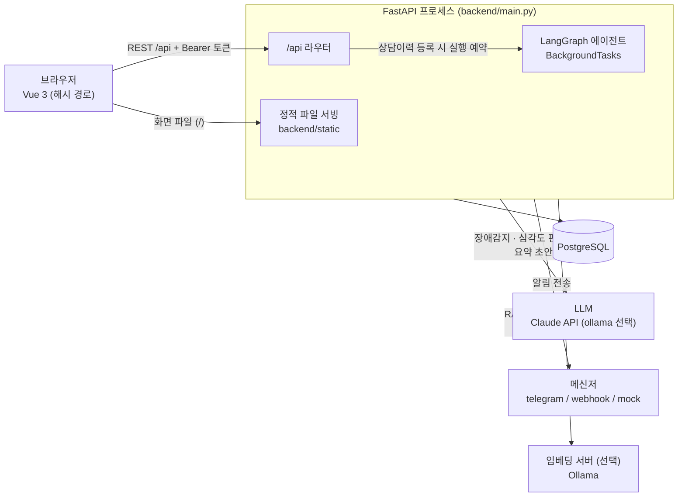
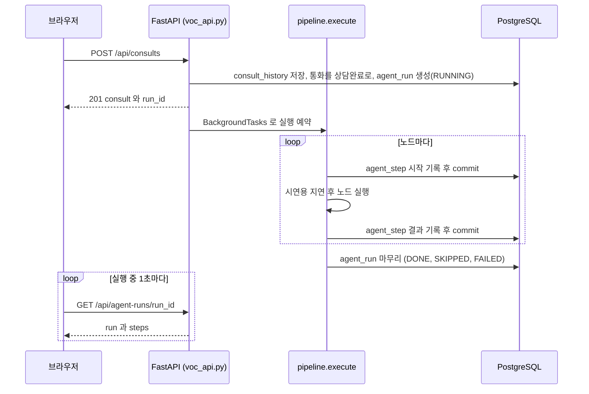
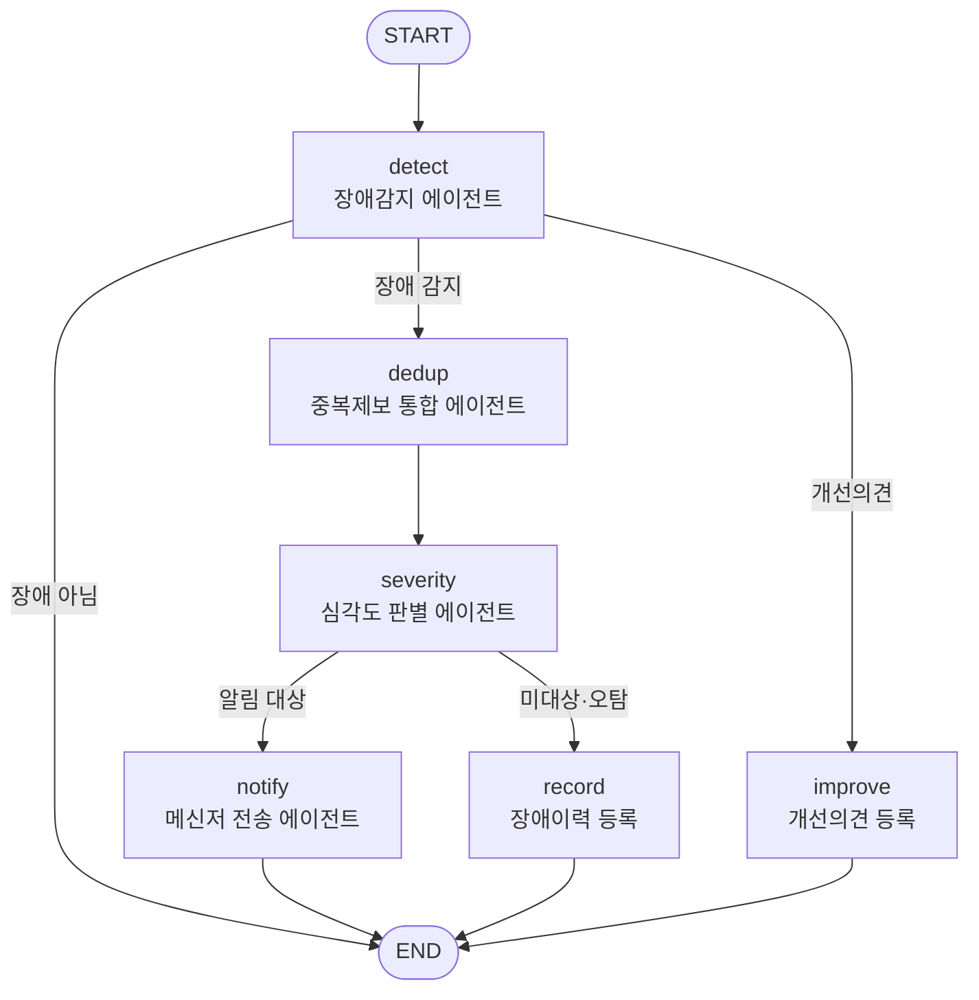
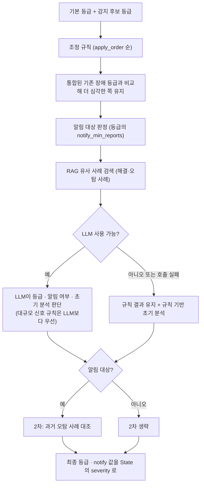
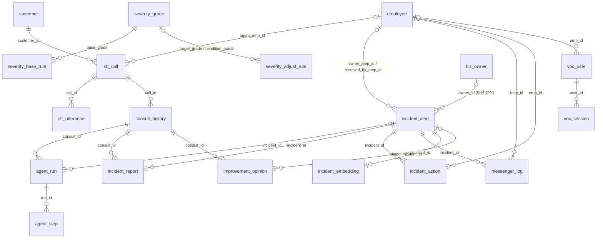
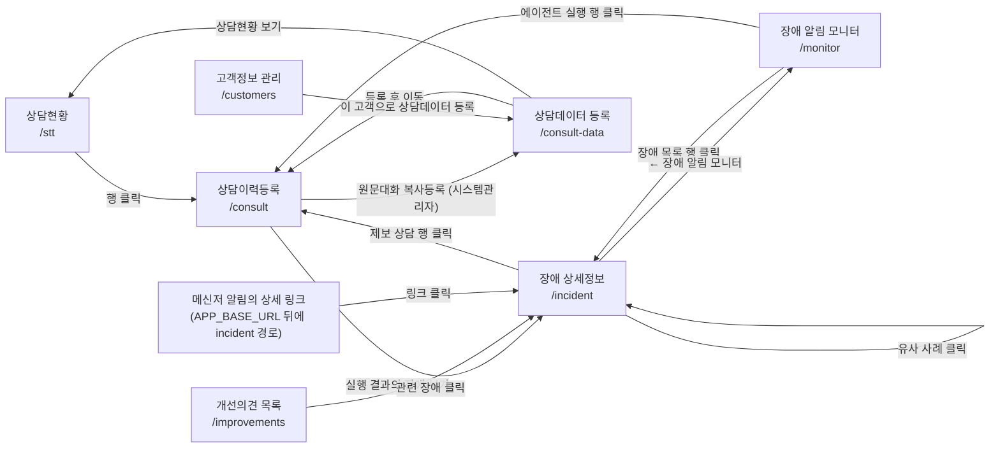

# 아키텍처

상태: 확인 대기  
근거: 구현된 코드(커밋 fba80ab)를 읽고 정리했습니다. 사람이 읽고 확인한 것은 아닙니다.

> 읽는 법
> - 표의 「근거」 칸과 괄호 안 경로는 저장소 루트 기준 파일입니다.
> - 「확인 못 함」은 코드만으로는 확인하지 못했다는 뜻입니다. 「이유 기록 없음」은 그렇게 만든 이유가 코드, README, 커밋 메시지 어디에도 없다는 뜻입니다.
> - 설정값은 이름과 뜻만 적고 값은 적지 않았습니다. 시연용 가상 데이터의 내용도 옮기지 않았습니다.
> - 코드 상수(코드 안에 박혀 있는 기준값)는 동작을 이해하는 데 필요해서 적었습니다.

## 1. 한눈에 보기

상담이 끝나 상담이력으로 등록되면, AI 에이전트가 그 상담의 STT 원문(통화 음성을 글로 옮긴 것)과 상담이력을 읽고 웹·앱 장애인지 판단해 담당 IT 담당자에게 메신저로 알립니다. 에이전트는 LangGraph(여러 단계를 그래프로 이어 실행하게 해 주는 라이브러리)로 만든 노드 6개이고, 한 번 실행에서는 그중 최대 4개를 지납니다(`backend/app/agents/graph.py`). FastAPI 서버 한 개가 REST API(`/api`)와 Vue 3 화면 파일을 함께 내려주고, 데이터는 PostgreSQL에 둡니다(`backend/main.py`). LLM(Claude API)은 장애 감지, 심각도 판별, 상담요약 초안에서 쓰이며 호출이 실패하면 규칙 기반 결과로 대체합니다(`backend/app/agents/llm.py`). 메신저 알림은 장애등급 P1일 때만 자동으로 나가고, P2는 「관찰」로 두었다가 센터관리자가 확인해 수동으로 보냅니다(초기 시드 기준, 판별기준 관리 화면에서 바꿀 수 있음. `backend/sql/04_severity_criteria.sql`, `backend/sql/13_observe_manual_notify.sql`).

### 1.1 전체 구성

| 구성 요소 | 하는 일 | 근거 |
|---|---|---|
| 브라우저 (Vue 3) | 로그인, 상담 처리, 장애 모니터링, 관리 화면. 화면 전환은 vue-router 없이 주소의 `#` 뒤 경로로 합니다. | `frontend/src/App.vue`, `frontend/src/composables/useHashRoute.js` |
| FastAPI | `/api` 아래 REST API. `backend/static` 폴더가 있으면 `/` 에서 Vue 빌드 결과도 서빙합니다(반드시 라우터 등록 뒤 맨 마지막). | `backend/main.py` |
| 에이전트 | 상담이력 등록 응답을 먼저 돌려준 뒤 같은 프로세스의 백그라운드(`BackgroundTasks`)에서 그래프를 실행합니다. | `backend/app/routers/voc_api.py`, `backend/app/agents/pipeline.py` |
| PostgreSQL | 모든 데이터. 과거 장애 임베딩(RAG)도 같은 DB에 둡니다. | `backend/app/database.py`, `backend/app/db_init.py` |
| LLM | 기본 provider는 Claude API(Anthropic Messages API를 httpx로 직접 호출). 설정으로 Ollama 또는 사용 안 함(규칙 기반)을 고를 수 있습니다. | `backend/app/agents/llm.py` |
| 메신저 | 텔레그램 봇, 웹훅, mock(DB 기록만) 중 하나. | `backend/app/services/messenger.py` |
| 임베딩 서버 | `RAG_SEARCH=embedding` 일 때만 Ollama `/api/embed` 를 호출합니다. 기본은 문자열 유사도라 쓰지 않습니다. | `backend/app/services/rag.py`, `backend/app/database.py` |

### 1.2 기술 구성

| 무엇 | 쓴 것 | 이유 | 근거 |
|---|---|---|---|
| 백엔드 | FastAPI, SQLAlchemy(대부분 `text()` 로 SQL 직접 작성), psycopg 3, pydantic-settings | 이유 기록 없음 | `backend/requirements.txt`, `backend/app/services/repo.py` |
| 에이전트 | LangGraph `StateGraph` | 이유 기록 없음(README는 「에이전트 오케스트레이션」이라고만 적음) | `backend/app/agents/graph.py`, `README.md` |
| LLM 호출 | SDK 없이 httpx로 직접 호출 | 「추가 패키지 없이」(코드 주석) | `backend/app/agents/llm.py` |
| 비밀번호 해시 | PBKDF2-SHA256, 표준 라이브러리 | 「추가 패키지 없음」(코드 주석) | `backend/app/services/auth.py` |
| 문자열 유사도 | 두 글자씩 쪼갠 조각의 겹침 비율(bigram Jaccard) | 「한국어에 추가 라이브러리 없이 동작」(코드 주석) | `backend/app/agents/rules.py` |
| RAG 기본 검색 방식 | 문자열 유사도(`text`) | 「배포 서버에서는 PC의 로컬 Ollama에 접근할 수 없으므로」(코드 주석) | `backend/app/database.py` |
| 임베딩 저장 | pgvector가 있으면 `vector` 컬럼, 없으면 `real[]` 컬럼 | pgvector 없는 PostgreSQL에서도 동작하게 하는 자동 대체(로그 문구). 그 이상의 이유 기록 없음 | `backend/app/db_init.py` |
| 에이전트 실행 방식 | FastAPI `BackgroundTasks` | 「상담이력 등록 응답은 바로 반환됩니다」(코드 주석) | `backend/app/agents/pipeline.py` |
| 프론트엔드 | Vue 3 + Vite + axios, 상태 관리·라우터 라이브러리 없음 | 이유 기록 없음 | `frontend/package.json` |
| 배포 이미지 | Vue 빌드 결과를 FastAPI의 `static` 으로 묶은 단일 이미지 | 「axhub 배포용」(Dockerfile 주석) | `Dockerfile` |
| 테스트 | 없음 | - | 11장 |

## 2. 폴더 구조

| 경로 | 무엇 | 근거 |
|---|---|---|
| `backend/main.py` | FastAPI 앱 진입점. 시작할 때 DB 초기화(`reset_once`, `init_if_empty`), CORS, `/api` 라우터 등록, 정적 파일 서빙 | `backend/main.py` |
| `backend/app/agents/` | `graph.py` 그래프 정의, `pipeline.py` 실행기, `detection.py` · `dedup.py` · `severity.py` · `notify.py` · `improve.py` 노드, `summary.py` 상담요약 초안(그래프 밖), `llm.py` LLM 호출, `rules.py` 키워드·유사도 규칙과 코드 기본값 | 각 파일 |
| `backend/app/routers/` | API 라우터 `voc_api.py` · `auth_api.py` · `admin_api.py` · `customer_api.py`, 연습용 `getRt.py` · `users_dao.py` | 각 파일 |
| `backend/app/services/` | `auth.py` 로그인·세션·권한, `criteria.py` 장애등급 판별기준 로더·관리, `rag.py` 임베딩·유사 사례 검색, `messenger.py` 메신저 전송, `repo.py` 조회·등록 SQL 모음(API와 에이전트가 같이 씀), `dialog_excel.py` 대화 엑셀 읽기·양식 | 각 파일 |
| `backend/app/database.py` | 설정(`Settings`, 환경변수)과 DB 엔진·세션 | `backend/app/database.py` |
| `backend/app/db_init.py` | 테이블 생성, 시드 입력, 초기화(`reset`), 첫 실행 자동 초기화 | `backend/app/db_init.py` |
| `backend/app/history_seed.py`, `history_scenarios.py` | 시연용 과거 상담 데이터 생성(DB 초기화 때 자동) | 각 파일 |
| `backend/sql/01~13_*.sql` | 테이블 정의와 시드. 5장 참고 | `backend/app/db_init.py` 의 `SQL_FILES` |
| `backend/scripts/init_db.py` | DB 초기화 명령(`--reset`, `--reset-users`) | `backend/scripts/init_db.py` |
| `backend/scripts/demo_scripts.py` | 시연 STT 원문에서 `sql/11_demo_scripts.sql` 과 `demo/stt_excel/*.xlsx` 를 만드는 스크립트 | `backend/scripts/demo_scripts.py` |
| `backend/demo/stt_excel/` | 시연 STT 원문 엑셀 22개(등급별 16개 + 사전 제보 6개). 상담데이터 등록 화면의 엑셀 업로드 양식과 같은 형식 | `backend/scripts/demo_scripts.py` |
| `backend/Dockerfile`, `Procfile`, `.gcloudignore`, `.dockerignore`, `.python-version`, `requirements.txt`, `.env.example` | 백엔드 단독 실행·배포용 파일. `backend/Dockerfile` 은 Cloud Run 경로가 씀 | `deploy.ps1`, `Dockerfile` 주석 |
| `backend/setup_secrets.ps1` | `.env` 의 Claude API 키를 Secret Manager에 등록하는 스크립트(Cloud Run 경로) | `backend/setup_secrets.ps1` |
| `backend/dbtest.py` | DB 연결을 확인해 보는 연습용 단독 FastAPI 앱. 저장소 안에서 이 파일을 쓰는 곳이 없습니다 | 저장소 전체 검색 |
| `frontend/` | Vue 3 + Vite. `src/App.vue` 메뉴·권한·화면 전환, `src/views/` 화면, `src/components/voc/` 화면 조각, `src/composables/` 로그인 상태·해시 경로·자동 갱신, `src/api/` axios 호출, `src/assets/voc.css` 공통 스타일 | `frontend/src/` |
| `frontend/.env.development`, `.env.production` | 빌드할 때 들어가는 API 주소(`VITE_API_BASE_URL`). 개발은 로컬 FastAPI, 운영은 같은 출처의 `/api` | 각 파일 |
| `Dockerfile` (루트) | axhub 배포용 단일 이미지: Vue 빌드 → FastAPI + `static` | `Dockerfile` |
| `axhub.yaml` | axhub 배포 설정(포트, 헬스체크 경로, 환경변수 선언) | `axhub.yaml` |
| `deploy.ps1` | Vue 빌드 → `backend/static` 복사 → Cloud Run 배포 | `deploy.ps1` |
| `README.md` | 실행 가이드와 기능별 변경 내역 | `README.md` |

## 3. 에이전트 흐름 (LangGraph)

### 3.1 실행 방식

상담이력을 등록하면 응답은 먼저 돌려주고, 에이전트는 응답 뒤에 백그라운드에서 돕니다. 화면은 실행 상태를 1초마다 물어 진행 과정을 보여 줍니다.

- 각 노드는 시작 때와 끝날 때 `agent_step` 을 DB에 commit 합니다. 그래서 다른 화면(모니터)에서도 진행 중인 단계를 볼 수 있습니다(`backend/app/agents/graph.py` 의 `_make_node`).
- 노드에서 예외가 나면 실행 중이던 단계를 `FAILED` 로 바꾸고 `agent_run.status` 를 `FAILED` 로 기록합니다(`backend/app/agents/pipeline.py`). LLM 호출 실패는 예외가 아니라 규칙 기반 대체로 처리되어 `FAILED` 가 되지 않습니다(3.3).
- `agent_run.status` 값은 `RUNNING` / `DONE` / `SKIPPED`(장애 아님으로 종료) / `FAILED` 입니다(`backend/sql/01_schema.sql`).
- 노드 사이에 시연용 지연이 들어갑니다(`AGENT_STEP_DELAY_SEC`, 11장).
- 그래프는 실행할 때마다 새로 만듭니다(`build_graph(db, run_id)`). 흐름도 정의는 `GRAPH_SPEC` 에 따로 있고 `GET /api/agent-graph` 가 돌려줍니다. 화면의 흐름도(`frontend/src/components/voc/AgentGraph.vue`)는 이 API를 쓰지 않고 SVG를 직접 그립니다.

### 3.2 그래프

조건 분기는 두 곳입니다(`backend/app/agents/graph.py`).

| 분기 | 조건 | 가는 곳 |
|---|---|---|
| `detect` 뒤 (`route_after_detect`) | `detection.category == "개선의견"` | `improve` |
| | `detection.is_incident` 가 참 | `dedup` |
| | 그 밖(일반 문의) | END. 이 단계가 `SKIPPED` 로 끝나고 실행 상태도 `SKIPPED` |
| `severity` 뒤 (`route_after_severity`) | `severity.notify` 가 참 | `notify` |
| | 거짓 | `record` |

### 3.3 노드별 정리

| 노드 (표시 이름) | 하는 일 | LLM | LLM을 못 쓸 때 | State에 담기는 값 | 근거 |
|---|---|---|---|---|---|
| `detect` (장애감지 에이전트) | STT 원문의 고객 발화 분석과 상담이력(상담유형·접촉채널·상담요약) 분석을 따로 하고 합쳐 판정합니다. 오류유형, 접촉채널, 제목, 증상, 재현 환경(OS·기기·앱 버전·브라우저·오류코드), 후보 등급을 만듭니다. 분류는 장애 / 개선의견 / 일반 | 선택. 두 분석 결과와 규칙 결과를 함께 주고 최종 판단과 구조화를 맡김 | 규칙 결과로 진행(`source`가 「규칙」). LLM 응답은 오류유형이 허용 목록에 있을 때만 채택 | `detection`, `customer_text`, `llm_used` | `backend/app/agents/detection.py` |
| `dedup` (중복제보 통합 에이전트) | 같은 오류유형의 미해결 장애와 증상 유사도로 비교해 같은 장애면 하나로 통합하고, 독립 고객 수로 대규모 신호를 판단합니다 | 안 씀 | 해당 없음 | `dedup` | `backend/app/agents/dedup.py` |
| `severity` (심각도 판별 에이전트) | 판별기준(DB)으로 1차 등급과 알림 대상 여부를 정하고, 과거 사례를 검색해(RAG) LLM에 주고, 알림 대상이면 2차로 과거 오탐 사례와 대조합니다. 3.4 참고 | 선택 | 판별기준 + 규칙 기반 초기 분석으로 진행(`source`가 「판별기준」) | `severity` | `backend/app/agents/severity.py` |
| `notify` (메신저 전송 에이전트) | 장애를 등록·갱신하고, 1차(담당 IT담당자)와 2차(비슷한 과거 장애 처리자) 수신자를 정해 메시지를 만들어 보냅니다. 이미 같거나 더 높은 등급으로 알림이 나갔으면 보내지 않습니다 | 안 씀 | 해당 없음. 전송이 실패해도 수신자별 `FAILED` 로 기록하고 노드는 끝납니다 | `notify`, `incident_id` | `backend/app/agents/notify.py` |
| `record` (장애이력 등록) | 메신저 없이 장애만 등록·갱신합니다. 상태는 오탐(2차 대조 일치) / 관찰 / 미대상 | 안 씀 | 해당 없음 | `notify`(`sent` 거짓), `incident_id` | `backend/app/agents/notify.py` 의 `run_record` |
| `improve` (개선의견 등록) | 개선의견을 기록하고, 최근 30일 장애 중 증상이 비슷한 것이 있으면 관련 장애로 연결합니다. 알림·누적 대상이 아닙니다 | 안 씀 | 해당 없음 | (State에 새 값을 넣지 않음) | `backend/app/agents/improve.py` |

규칙 기반 판정의 기준(`backend/app/agents/rules.py`, `detection.py`)

- 고객 발화에서 장애 신호어가 있고 오류유형이 「기타」가 아니거나 신호어가 2개 이상이면 STT 쪽 장애로 봅니다.
- 상담유형이 「전산오류문의」이고 신호어나 유형이 잡히거나, 요약에 신호어가 2개 이상이면 상담이력 쪽 장애로 봅니다.
- 개선의견은 「개선 요청 표현」과 「해결·완료 표현」이 함께 있고 「지금도 막힘 표현」이 없을 때입니다. 개선의견이면 상담이력과 상관없이 장애로 보지 않습니다.
- 둘 중 하나라도 장애로 식별되면 장애 대상입니다. 이 규칙은 한국어 키워드·정규식 사전에 의존합니다.

중복 통합 규칙(`backend/app/agents/dedup.py`, `backend/app/services/repo.py`)

1. 「일시 실패 후 정상 진행」 규칙(`RECOVERED_P3`)의 단어가 고객 발화에 있으면 미해결 장애에 합치지 않고 별도 건으로 진행합니다.
2. 같은 오류유형이고 상태가 관찰·접수·확인중·미대상인 장애 중 마지막 제보가 시간창(`DEDUP_WINDOW_MIN`) 안인 것을 후보로 잡습니다. 미대상도 후보에 들어가므로 추가 제보가 쌓이면 다시 판정됩니다.
3. 점수는 증상 유사도(bigram Jaccard)입니다. 증상 유사도가 0.20 미만이면 다른 장애로 봅니다(코드 상수 `MIN_SYMPTOM_SIMILARITY`). 0.20 이상이면 접촉채널 일치 +0.15, OS·앱 버전·오류코드가 같을 때마다 +0.10을 더합니다.
4. 점수가 0.30 이상(코드 상수 `MERGE_THRESHOLD`)이면 가장 높은 후보에 합칩니다. 제보(`incident_report`)를 추가하고, 연결된 상담의 서로 다른 고객 수(`customer_count`)를 세어 기준 이상이면 `mass_signal` 을 켭니다. 같은 고객의 재문의는 1명입니다.
5. 대규모 신호 기준은 판별기준의 `MASS_SIGNAL` 규칙 `threshold` 가 우선이고, 규칙이 없을 때만 `MASS_SIGNAL_THRESHOLD` 를 씁니다(`backend/app/services/criteria.py`). 초기 시드 기준은 독립 고객 3명입니다(`backend/sql/04_severity_criteria.sql`).

### 3.4 심각도 판별 안쪽

판별기준은 DB 테이블 3개(`severity_grade`, `severity_base_rule`, `severity_adjust_rule`)에서 읽고, 사용 중(`use_yn`)이면서 적용 기간 안인 행만 씁니다. 테이블이 없거나 비어 있으면 `rules.py` 의 코드 기본값을 씁니다. 읽은 값은 5초 동안 메모리에 둡니다(`backend/app/services/criteria.py`).

1. 기본 등급: 오류유형과 접촉채널이 모두 맞는 규칙이 우선, 없으면 채널 무관 규칙, 그것도 없으면 가장 낮은 등급.
2. 감지 단계의 후보 등급이 더 심각하면 그 등급을 씁니다.
3. 조정 규칙을 `apply_order` 순서로 적용합니다. 규칙 종류는 `KEYWORD`(키워드 일치. `그룹:단어` 형식은 그룹마다 하나 이상 있어야 함), `REPORT_COUNT`(누적 제보 건수), `MASS_SIGNAL`(대규모 신호). `FALSE_POSITIVE` 는 여기서 건너뜁니다. 동작은 `RAISE`(몇 단계 올림), `SET_GRADE`(등급 지정), `RAISE_TO`(최소 이 등급), `LOWER_TO`(최대 이 등급, 대규모 신호면 적용 안 함)입니다.
4. 중복 통합된 장애면 기존 등급과 비교해 더 심각한 쪽을 유지합니다.
5. 알림 대상은 해당 등급의 `notify_min_reports` 가 비어 있지 않고 누적 제보 건수가 그 이상일 때입니다. 초기 시드는 P1만 값이 있고 나머지는 비어 있습니다.
6. LLM을 쓸 수 있으면 LLM이 돌려준 등급이 규칙 결과를 대체합니다. 등급 코드가 유효할 때만 채택하며, 대규모 신호가 켜져 있고 `MASS_SIGNAL` 규칙에 지정 등급이 있으면 그 등급이 LLM 판단보다 우선합니다. LLM이 돌려주는 `notify` 값은 쓰지 않고, 알림 대상 여부는 바뀐 등급을 판별기준(`notify_min_reports`)에 다시 대어 정합니다.
7. 2차 대조는 알림 대상일 때만 합니다. 오탐 규칙(`FALSE_POSITIVE`)이 있고, 검색된 사례 중 상태가 「오탐」이면서 유사도가 기준 이상인 것이 있고, 고객 발화에 오탐 규칙의 단어가 있고, 대규모 신호가 아닐 때 오탐으로 판정해 알림에서 제외하고 등급을 규칙의 지정 등급(없으면 최하위)으로 내립니다.

초기 시드로 들어 있는 조정 규칙(`backend/sql/04_severity_criteria.sql`, `backend/sql/10_impact_improvement.sql`)

| 규칙 코드 | 종류 → 동작 | 뜻 |
|---|---|---|
| `PERSIST_P2` | `KEYWORD` → `RAISE_TO` | 재시도·재설치 후에도 같은 오류가 이어지면 최소 P2 |
| `ESC_IMPACT` | `KEYWORD` → `RAISE` | 금전 피해·다수 영향 표현이 있으면 1단계 상향 |
| `URGENT_P1` | `KEYWORD` → `RAISE_TO` | 기한 임박, 대체수단 없음, 지속 차단이 모두 확인되면 P1 |
| `RPT_MULTI` | `REPORT_COUNT` → `SET_GRADE` | 같은 장애로 2건 이상 제보되면 P4를 P3로 |
| `RECOVERED_P3` | `KEYWORD` → `LOWER_TO` | 일시 실패 후 정상 진행이 확인되면 최대 P3 |
| `MASS_P1` | `MASS_SIGNAL` → `SET_GRADE` | 독립 고객 수가 기준 이상이면 P1 |
| `FP_CUSTOMER` | `FALSE_POSITIVE` → `FALSE_POSITIVE` | 과거 오탐 사례와 비슷하고 고객 귀책 표현이 있으면 알림 제외 |

### 3.5 State에 담기는 값

`AgentState` (`backend/app/agents/graph.py`)

| 키 | 담기는 값 | 넣는 곳 |
|---|---|---|
| `consult`, `call` | 등록된 상담이력, STT 통화(발화 목록 포함) | `pipeline.execute` 가 시작할 때 |
| `customer_text` | 고객 발화만 이어 붙인 글. 고객 발화가 없으면 상담요약 | `detect` |
| `detection` | 분류(장애/개선의견/일반), 오류유형, 접촉채널, 후보 등급, 제목, 증상, 재현 환경, 신뢰도, 근거, STT·상담이력 각각의 분석 | `detect` |
| `dedup` | 통합 여부, 대상 장애 번호, 유사도, 누적 제보 수, 독립 고객 수, 대규모 신호 여부, 비교한 후보 | `dedup` |
| `severity` | 최종 등급, 알림 여부, 오탐 여부, 1차·2차 결과, 판단 근거 목록, 유사 사례, 초기 분석, 적용 규칙 코드, 판별기준 버전, RAG 방식 | `severity` |
| `notify` | 장애 번호, 장애 상태, 등급, 전송 여부, 수신자, 상세 링크 | `notify` / `record` |
| `incident_id` | 등록·갱신된 장애의 내부 번호 | `notify` / `record` |
| `llm_used` | 이번 실행에서 LLM 응답을 실제로 채택했는지 | `detect`, `severity` |
| `path`, `status`, `outcome` | 지난 노드 목록, 마지막 노드의 상태(`DONE` / `SKIPPED`), 마지막 노드의 결과 메시지 | 노드 공통 래퍼 |

장애 번호 표시는 `ERR-0001` 형식입니다. DB에는 `incident_id`(내부 번호)에서 계산되는 생성 컬럼 `incident_no` 가 있고, 화면·API 경로는 내부 번호를 씁니다(`backend/sql/12_incident_no.sql`, `backend/app/services/repo.py`).

## 4. LLM · RAG

### 4.1 provider 선택과 호출

`LLM_PROVIDER` 로 고릅니다(`backend/app/agents/llm.py`).

| 값 | 쓰이는 조건 | 호출 |
|---|---|---|
| `anthropic` (기본) | `ANTHROPIC_API_KEY` 가 비어 있지 않을 때 | Anthropic Messages API를 httpx로 호출. 요청에 모델(`LLM_MODEL`), `max_tokens`, system, user 메시지, `output_config.effort`(`LLM_EFFORT`)를 담습니다. 그 밖의 thinking 설정은 코드에 없습니다. |
| `ollama` | 모델이 있고, (API 키가 있거나 주소가 Ollama Cloud가 아님) | `OLLAMA_BASE_URL` 의 `/api/chat`. JSON 출력 강제(`format: json`), 온도 낮게 고정. 400 응답이면 `format` 없이 한 번 더 시도합니다. |
| `none` 또는 그 외 | - | 호출하지 않고 규칙 기반으로 진행 |

- 모든 호출은 「JSON 객체 하나만 출력」 지시를 system 끝에 붙이고, 응답에서 JSON을 뽑습니다(코드 펜스 또는 첫 `{` 부터 마지막 `}`).
- 제한 시간은 `LLM_TIMEOUT_SEC` 입니다. Anthropic 호출은 재시도하지 않습니다(Ollama는 위 표의 400 응답 한 번만 재시도). 실패(연결 오류, 오류 응답, JSON 파싱 실패)는 모두 `None` 으로 돌려주고 호출한 노드가 규칙 기반으로 계속합니다.
- 모니터 화면 상단 배지가 현재 상태(LLM 종류·모델, RAG 방식, 메신저 방식)를 보여 줍니다. `GET /api/monitor/summary` 가 값을 줍니다(`backend/app/routers/voc_api.py`).

### 4.2 프롬프트에 넣는 것

| 호출 | system 프롬프트 | user 프롬프트에 넣는 것 | 응답 JSON | max_tokens | 근거 |
|---|---|---|---|---|---|
| 장애 감지 | 금융 콜센터 상담을 보고 웹·앱 전산 장애를 감지하는 역할. 상담사 마무리·전달 멘트는 판단 근거에서 제외, 분류 기준(장애/개선의견/일반) | STT 원문 전체(상담사·고객 구분), 상담이력(고객번호, 상담유형, 접촉채널, 접촉결과, 상담요약), 규칙 기반 1차 분석 결과 3종 | 분류, STT·상담이력 각각의 장애 여부와 근거, 오류유형, 접촉채널, 후보 등급, 제목, 증상, 재현 환경, 신뢰도 | 기본 1500 | `backend/app/agents/detection.py` |
| 심각도 판별 | 금융 IT 장애 심각도 판별 역할. 판별기준 DB의 등급 정의와 판단 예시를 그대로 붙임. 등급은 고객이 말한 사실로 판단, 상담사 멘트 제외, 과거 사례는 참고만 | 고객 발화만, 감지 결과, 중복 통합 결과(누적 제보 수, 독립 고객 수, 대규모 신호), 규칙 기반 1차 판별(등급·알림 여부·근거), 과거 유사 사례(조건은 4.3) | 등급, 알림 여부, 초기 분석(3~5문장), 판단 근거, 참고한 과거 장애번호 | 기본 1500 | `backend/app/agents/severity.py` |
| 상담요약 초안 | 상담사 입장에서 `[문의]` `[확인]` `[처리]` 3줄(300자 이내)로 요약, 대화에 없는 내용은 추측 금지, 개인정보 기재 금지 | STT 원문 전체 | 요약 문자열 | 600 | `backend/app/agents/summary.py` |

- 상담요약 초안은 그래프 밖에서 `POST /api/stt/{call_id}/summary-draft` 요청 안에서 동기로 호출됩니다. LLM이 꺼져 있거나 실패하면 같은 형식을 규칙으로 만들어 돌려주며 응답의 `source` 가 「LLM」 또는 「규칙」입니다.
- 심각도 프롬프트의 과거 사례는 장애번호, 상태, 제목, 유형, 등급, 유사도, 증상(앞 150자), 처리결과(앞 200자)입니다.
- 상담 원문과 상담이력 문장이 LLM 호출에 그대로 들어갑니다. 이 프로젝트는 시연 데이터가 모두 가상이고 실제 고객 정보를 넣지 않는다는 전제입니다([지킬 것](../../harness/ground-rules.md)).

### 4.3 RAG (과거 해결·오탐 사례 검색)

지식베이스는 `incident_alert` 중 상태가 「해결」 또는 「오탐」인 장애입니다. 검색 결과는 (a) 심각도 LLM 프롬프트, (b) 초기 분석 문구, (c) 2차 오탐 대조, (d) 메신저의 과거 해결 사례와 2차 수신자(과거 처리자)에 씁니다. `RAG_IN_LLM` 을 끄면 (a)만 빠지고 나머지는 그대로 씁니다(`backend/app/agents/severity.py`, `backend/app/agents/notify.py`).

| | `text` (기본) | `embedding` |
|---|---|---|
| 설정 | `RAG_SEARCH=text` | `RAG_SEARCH=embedding` |
| 방법 | 장애 제목·증상·고객 발화와 사례의 「제목 + 증상」을 bigram Jaccard로 비교. 오류유형이 같으면 +0.1 | 질의(제목, 증상, 고객 발화 앞 600자)를 Ollama `/api/embed` 로 임베딩하고 코사인 유사도 비교 |
| 대상 | 최근 해결·오탐 장애 최대 200건(`repo.search_knowledge`) | `incident_embedding` 의 해당 모델 임베딩 |
| 결과 | 유사도 0.1 이상 상위 3건 | 상위 3건 중 유사도가 `RAG_MIN_SIMILARITY` 이상인 것 |
| 오탐 일치 기준 | 0.25 (코드 상수 `BIGRAM_FP_THRESHOLD`) | `RAG_FP_SIMILARITY` |
| 외부 의존 | 없음 | 임베딩 서버(Ollama). 모델은 `OLLAMA_EMBED_MODEL` |
| 저장소 | 사용 안 함 | pgvector가 있으면 `vector` 컬럼과 `<=>`(코사인 거리) 연산으로 DB에서 검색, 없으면 `real[]` 컬럼에서 읽어 파이썬으로 계산 |

근거: `backend/app/services/rag.py`, `backend/app/agents/severity.py`, `backend/app/services/repo.py`.

대체 동작

- `embedding` 인데 임베딩 테이블이 없거나, 임베딩 서버가 응답하지 않으면 `text` 방식으로 대체합니다. 임베딩 서버가 실패하면 일정 시간(코드 상수 30초) 동안 다시 시도하지 않습니다(`rag.py`).
- `embedding` 에서 결과가 0건인 경우는 대체하지 않고 「사례 없음」으로 처리합니다(대체는 `None` 일 때만).
- 모니터 배지는 임베딩 서버 실패 시 「문자열 유사도 대체」를 표시합니다(`frontend/src/views/IncidentMonitorView.vue`).
- 검색 자체가 예외로 실패하면 사례 0건으로 진행하고 오탐 일치 기준을 넘길 수 없는 값으로 둡니다(`severity.py`).

지식베이스가 늘어나는 시점

- 장애가 해결·오탐으로 바뀔 때(IT담당자 처리 등록, 센터관리자 종결, `PATCH /api/incidents/{id}`) 백그라운드로 해당 장애 임베딩을 만듭니다(`backend/app/routers/voc_api.py` 의 `_embed_incident`). `embedding` 모드가 아니면 아무것도 하지 않습니다.
- `embedding` 모드의 검색 직전에도 임베딩이 없는 해결·오탐 장애를 채웁니다(`ensure_embeddings`).
- 임베딩할 글은 제목, 유형·채널, 증상, 처리결과입니다(`incident_content`).
- 「미대상」으로 종결된 장애는 지식베이스에 넣지 않습니다(상태 조건이 해결·오탐뿐). `backend/sql/13_observe_manual_notify.sql` 주석에도 같은 취지가 있습니다.

## 5. 데이터

### 5.1 테이블 관계

`consult_history.customer_id` 에는 외래 키가 없습니다(`stt_call.customer_id` 에만 있음, `backend/sql/01_schema.sql`, `backend/sql/08_customer_consult_data.sql`).

### 5.2 테이블 목록과 핵심 컬럼

| 테이블 | 만들어지는 곳 | 뜻 | 핵심 컬럼 |
|---|---|---|---|
| `stt_call` | 01 (+06 상담상태, +08 고객·상담사 연결) | 통화 1건 | `call_id`, `customer_id`, `agent_emp_id`, `started_at`, `duration_sec`, `consult_status`(진행 / 상담완료), `completed_at` |
| `stt_utterance` | 01 (+06) | 통화의 발화(STT 원문) | `call_id`, `seq`, `speaker`(AGENT / CUSTOMER), `offset_sec`, `text`, `added_by` |
| `consult_history` | 01 (+06) | 상담이력 | `consult_id`, `call_id`, `customer_id`, `consult_type`(전산오류문의 / 일반문의 / 불만 / 기타), `channel`, `summary`, `result_status`(완료 / 이관 / 보류), `registered_by` |
| `customer` | 08 | 고객정보. 고객번호는 시퀀스로 채번 | `customer_id`, `customer_name`, `phone`(중복 불가), `gender`, `age` |
| `employee` | 05 | 인사정보(상담사 / 센터관리자 / IT담당자) | `emp_id`, `emp_no`, `emp_group`, `duty_role`(담당 / 부담당 / 팀장), `duty_error_types`(배열), `messenger_id`, `on_duty`, `use_yn` |
| `voc_user` | 05 (+09 권한 4종) | 로그인 계정 | `login_id`, `password_hash`, `auth_role`, `emp_id`, `use_yn`, `fail_count` |
| `voc_session` | 05 | 로그인 세션 | `token_hash`(SHA-256), `user_id`, `expires_at`, `last_seen_at` |
| `biz_owner` | 01 | 이전 방식의 업무담당자. 05에서 `employee` 로 옮겨졌고 `GET /api/owners` 와 일부 조인에만 남아 있음 | `owner_id`, `error_type`, `role`, `messenger_id` |
| `incident_alert` | 01 (+04, 06, 10, 12, 13) | 장애. RAG 지식베이스를 겸함 | `incident_id`, `incident_no`(생성 컬럼), `title`, `error_type`, `channel`, `severity`, `status`(관찰 / 접수 / 확인중 / 해결 / 오탐 / 미대상), `report_count`, `customer_count`, `mass_signal`, `symptoms`, `env_info`(JSONB), `analysis`, `similar_cases`(JSONB), `notified_severity`, `resolution`, `owner_emp_id`, `resolved_by_emp_id`, `criteria_version`, `applied_rules`(JSONB), `first_reported_at`, `last_reported_at`, `resolved_at` |
| `incident_report` | 01 | 장애와 상담의 연결(중복 통합 결과). (장애, 상담) 쌍은 유일 | `incident_id`, `consult_id`, `similarity` |
| `incident_action` | 07 (+13) | 장애 처리 이력 | `incident_id`, `process_status`, `status_before`, `status_after`, `content`, `emp_id`, `actor_login` |
| `messenger_log` | 01 (+06) | 메신저 전송 이력(수신자마다 1행) | `incident_id`, `emp_id`, `recipient_type`(1차 / 2차), `receiver`, `title`, `body`, `transport`, `status`(SENT / FAILED), `error_message`, `link_url` |
| `agent_run` | 01 | 에이전트 실행 1회 | `run_id`, `consult_id`, `status`, `outcome`(200자까지), `incident_id`, `llm_used` |
| `agent_step` | 01 | 실행의 노드별 단계 | `run_id`, `seq`, `agent_name`, `status`, `message`, `output`(JSONB) |
| `improvement_opinion` | 10 | 개선의견(알림·누적 대상 아님) | `consult_id`, `title`, `content`, `customer_excerpt`, `related_incident_id` |
| `severity_grade` | 04 (+13 `observe_yn`) | 등급 정의 | `grade_code`(P1~P4), `grade_order`, `definition`, `judge_examples`, `notify_min_reports`, `observe_yn`, `recipient_roles`, `message_prefix`, `use_yn`, `valid_from`, `valid_to` |
| `severity_base_rule` | 04 | 오류유형·접촉채널별 기본 등급 | `error_type`, `channel`, `base_grade` |
| `severity_adjust_rule` | 04 (+10 동작 종류 추가) | 등급 조정 규칙 | `rule_code`, `rule_type`, `action_type`, `keywords`(배열), `threshold`, `target_grade`, `condition_grade`, `apply_order` |
| `incident_embedding` | SQL이 아니라 `db_init.py` 의 `create_embedding_table` | RAG 임베딩(1장애 1행) | `incident_id`, `model`, `content`, `content_hash`, `embedding`(`vector` 또는 `real[]`) |
| `app_meta` | `reset_once()` 가 필요할 때 만듦 | `DB_RESET_TOKEN` 마지막 적용값 기록 | `key`, `value` |

시퀀스 `customer_no_seq`(고객번호), `stt_call_no_seq`(통화 번호)는 08에서 만듭니다. 판별기준 3개 테이블에는 수정자·변경 사유·적용 기간 컬럼이 있고, 수정 이력 전용 테이블은 없습니다(`backend/sql/04_severity_criteria.sql`).

### 5.3 SQL 파일과 시드

`init_schema()` 가 아래 순서로 실행합니다(`backend/app/db_init.py` 의 `SQL_FILES`). 모두 여러 번 실행해도 되게 쓰여 있습니다. 실행 뒤 임베딩 테이블을 만들고, 마지막으로 과거 상담 데이터를 넣습니다.

| 파일 | 내용 |
|---|---|
| `01_schema.sql` | 기본 테이블 9개 |
| `02_seed.sql` | 시연용 통화·발화, 업무담당자, 과거 해결·오탐 장애(RAG 지식베이스 시작점) |
| `04_severity_criteria.sql` | 판별기준 3개 테이블과 초기 기준 |
| `05_users_hr.sql` | 인사정보·계정·세션 테이블, 인사정보와 초기 계정 3개(시스템관리자·상담사·IT담당자 각 1개) |
| `06_consult_agent.sql` | 상담상태, 담당자·처리자 연결, 메신저 수신 구분 |
| `07_incident_process.sql` | 장애 처리 이력 |
| `08_customer_consult_data.sql` | 고객정보, 시퀀스, 통화-고객·상담사 연결 |
| `09_auth_roles.sql` | 권한 4종 제약, 예전 권한 체계의 계정 변환 |
| `10_impact_improvement.sql` | 영향 기반 조정 규칙, 독립 고객 수, 개선의견 |
| `11_demo_scripts.sql` | 등급별 시연 STT 원문 16건 + 누적 제보용 사전 통화 6건(`scripts/demo_scripts.py` 가 생성, 시연용 가상 데이터) |
| `12_incident_no.sql` | 장애번호 생성 컬럼 |
| `13_observe_manual_notify.sql` | 관찰 여부, 처리 이력 상태 확장 |

- `03_pgvector.sql` 은 자동 실행 목록에 없습니다. Cloud SQL 콘솔에서 손으로 실행하는 용도의 대체 파일이고, 앱은 같은 일을 `create_embedding_table` 로 합니다(`backend/sql/03_pgvector.sql` 첫 주석, `db_init.py`).
- 과거 상담 데이터(`backend/app/history_seed.py`): 2026-10-15부터 10-28까지 하루 20건의 통화를 만듭니다. 10-27까지는 상담이력과 에이전트 실행 이력, 장애, 메신저 이력까지 만들고 마지막 날은 「진행」 상태 통화만 둡니다. 시연용 가상 데이터이고 날짜가 코드에 고정돼 있습니다(11장).
- DB를 만들고 초기화하는 방법은 배포 문서에 정리했습니다(`docs/deploy/deploy.md`).

## 6. API

모든 경로 앞에 `/api` 가 붙습니다(`backend/main.py`). 권한 칸의 「로그인」은 로그인한 모든 사용자입니다. 요청마다 `Authorization: Bearer 토큰` 이 필요하며(`AUTH_REQUIRED` 가 꺼진 개발 모드는 예외), 토큰이 없거나 만료되면 401, 권한이 맞지 않으면 403입니다(`backend/app/services/auth.py`). `/docs` 같은 자동 API 문서는 `ENABLE_DOCS` 를 켰을 때만 열립니다.

### 6.1 로그인 (`backend/app/routers/auth_api.py`)

| 메서드 | 경로 | 하는 일 | 필요한 권한 |
|---|---|---|---|
| POST | `/auth/login` | 아이디·비밀번호로 로그인, 토큰과 사용자 정보 반환 | 없음 |
| GET | `/auth/me` | 현재 사용자(새로고침 때 로그인 유지 확인) | 로그인 |
| POST | `/auth/logout` | 세션 삭제 | 없음(토큰이 있으면 그 세션을 지움) |
| POST | `/auth/password` | 본인 비밀번호 변경. 다른 기기 세션은 종료 | 로그인 |

### 6.2 상담·장애·에이전트 (`backend/app/routers/voc_api.py`)

| 메서드 | 경로 | 하는 일 | 필요한 권한 |
|---|---|---|---|
| GET | `/stt` | 통화 목록(키워드, 상담상태, 통화 시작일 기간, 등록 여부) | 로그인 |
| GET | `/stt/{call_id}` | 통화 상세(발화 목록, 마지막 상담이력과 실행 결과 포함) | 로그인 |
| POST | `/stt/{call_id}/summary-draft` | 상담요약 초안 작성(LLM, 실패 시 규칙) | 상담사 · 센터관리자 · 시스템관리자 |
| POST | `/stt/{call_id}/utterances` | 진행 중인 통화에 대화 추가 | 시스템관리자 |
| GET | `/consults` | 상담이력 목록 | 로그인 |
| GET | `/consults/{consult_id}` | 상담이력 1건 | 로그인 |
| POST | `/consults` | 상담이력 등록, 통화를 상담완료로, 에이전트 실행 예약 | 상담사 · 센터관리자 · 시스템관리자 |
| GET | `/owners` | 업무담당자 목록(이전 방식 테이블) | 로그인 |
| GET | `/incidents` | 장애 목록(모니터 박스, 등록일 기간, 상태 필터) | 로그인 |
| GET | `/incidents/{incident_id}` | 장애 상세(제보, 메신저 이력, 처리 이력 포함) | 로그인 |
| POST | `/incidents` | 장애 직접 등록 | 로그인(역할 제한 없음) |
| PATCH | `/incidents/{incident_id}` | 장애 상태·등급·담당·처리 결과 갱신 | 로그인(역할 제한 없음) |
| POST | `/incidents/{incident_id}/actions` | 처리 상태(대기중 / 진행중 / 오탐 / 처리완료)와 처리 내용 등록. 처리완료·오탐은 내용 필수, 관찰·미대상 장애는 불가 | IT담당자 |
| GET | `/incidents/{incident_id}/manual-notify` | 관찰·미대상 장애의 수동 알림 미리보기(추천 수신자, 자동 작성 메시지) | 센터관리자 · 시스템관리자 |
| POST | `/incidents/{incident_id}/manual-notify` | 수동 알림 전송, 상태를 접수(대기중)로 | 센터관리자 · 시스템관리자 |
| POST | `/incidents/{incident_id}/close` | 알림 없이 종결(미대상 또는 오탐) | 센터관리자 · 시스템관리자 |
| GET | `/improvements` | 개선의견 목록 | 로그인 |
| POST | `/messenger/send` | 메시지 전송(직원 번호 또는 메신저 ID 지정) | 로그인(역할 제한 없음) |
| GET | `/messenger/logs` | 메신저 전송 이력 | 로그인 |
| GET | `/messenger/telegram/chats` | 텔레그램 봇에게 최근 메시지를 보낸 대화 목록(chat_id 확인용) | 로그인(역할 제한 없음) |
| GET | `/agent-runs` | 에이전트 실행 이력(단계 포함) | 로그인 |
| GET | `/agent-runs/{run_id}` | 실행 1건 | 로그인 |
| POST | `/agent-runs` | 상담이력에 대해 에이전트 재실행 | 시스템관리자 |
| GET | `/monitor/counts` | 모니터 건수 박스 6개 | 로그인 |
| GET | `/monitor/summary` | 오늘 지표, LLM·RAG·메신저 상태, 등급 이름, 판별기준 버전 | 로그인 |
| GET | `/agent-graph` | 그래프 정의와 mermaid 텍스트 | 로그인 |

### 6.3 장애등급 판별기준 (`backend/app/routers/voc_api.py`)

| 메서드 | 경로 | 하는 일 | 필요한 권한 |
|---|---|---|---|
| GET | `/severity-criteria` | 등급·기본 규칙·조정 규칙 전체와 적용 중인 버전 | 시스템관리자 |
| POST | `/severity-criteria/grades` | 등급 정의 등록 | 시스템관리자 |
| PATCH | `/severity-criteria/grades/{grade_code}` | 등급 정의 수정 | 시스템관리자 |
| POST | `/severity-criteria/base-rules` | 기본 등급 규칙 등록 | 시스템관리자 |
| PATCH | `/severity-criteria/base-rules/{rule_id}` | 기본 등급 규칙 수정 | 시스템관리자 |
| POST | `/severity-criteria/adjust-rules` | 조정 규칙 등록 | 시스템관리자 |
| PATCH | `/severity-criteria/adjust-rules/{rule_code}` | 조정 규칙 수정(`use_yn` 으로 끄기) | 시스템관리자 |

수정자는 로그인 아이디로 기록됩니다. 삭제 API는 없습니다(규칙은 `use_yn` 으로 끕니다). 에이전트는 판별기준을 5초 동안 메모리에 두고 쓰므로, 수정을 받은 인스턴스는 바로, 다른 인스턴스는 최대 5초 뒤에 반영됩니다(`backend/app/services/criteria.py`).

### 6.4 사용자·인사정보 (`backend/app/routers/admin_api.py`)

| 메서드 | 경로 | 하는 일 | 필요한 권한 |
|---|---|---|---|
| GET | `/voc-users` | 사용자 목록 | 시스템관리자 |
| GET | `/voc-users/{user_id}` | 사용자 상세 | 시스템관리자 |
| POST | `/voc-users` | 사용자 등록 | 시스템관리자 |
| PATCH | `/voc-users/{user_id}` | 사용자 수정, 비밀번호 초기화, 잠금 해제 | 시스템관리자 |
| GET | `/employees` | 직원 목록(그룹, 오류유형, 근무 여부 필터) | 로그인 |
| GET | `/employees/{emp_id}` | 직원 상세(연결된 계정 포함) | 로그인 |
| POST | `/employees` | 직원 등록 | 시스템관리자 |
| PATCH | `/employees/{emp_id}` | 직원 수정 | 시스템관리자 |

### 6.5 고객·상담데이터 (`backend/app/routers/customer_api.py`)

| 메서드 | 경로 | 하는 일 | 필요한 권한 |
|---|---|---|---|
| GET | `/customers` | 고객 목록(최근 상담 시각 포함) | 로그인 |
| GET | `/customers/{customer_id}` | 고객 상세 | 로그인 |
| POST | `/customers` | 고객 등록(고객번호 자동 채번, 핸드폰번호 형식·중복 검사) | 시스템관리자 |
| PATCH | `/customers/{customer_id}` | 고객 수정(이름을 바꾸면 진행 중인 상담에도 반영) | 시스템관리자 |
| POST | `/stt` | 상담데이터 등록(통화와 대화를 만들고 상담상태 「진행」) | 시스템관리자 |
| POST | `/stt/dialog-excel` | 대화 엑셀(.xlsx, 2MB 이하)을 읽어 대화 목록만 반환(저장 안 함) | 시스템관리자 |
| GET | `/stt/dialog-excel/template` | 대화 엑셀 양식 내려받기 | 시스템관리자 |
| GET | `/stt/{call_id}/dialog-excel` | STT 원문을 업로드 양식과 같은 엑셀로 내려받기 | 시스템관리자 |

### 6.6 연습용 (`backend/app/routers/getRt.py`, `users_dao.py`)

| 메서드 | 경로 | 하는 일 | 필요한 권한 |
|---|---|---|---|
| GET | `/wellcom` | 고정 문구 응답 | 없음 |
| GET | `/users` | `public.users` 테이블 조회 | 없음 |
| GET | `/users/{user_id}` | `public.users` 1건 조회 | 없음 |

## 7. 인증과 권한

근거: `backend/app/services/auth.py`, `backend/app/routers/auth_api.py`, `backend/app/routers/admin_api.py`, `frontend/src/composables/useAuth.js`, `frontend/src/api/authToken.js`, `frontend/src/api/http.js`.

### 7.1 로그인 방식

- 방식은 토큰 기반 세션입니다. 로그인하면 서버가 임의의 토큰을 만들어 돌려주고, DB(`voc_session`)에는 토큰의 SHA-256 해시만 저장합니다. 브라우저는 토큰을 `localStorage` 에 두고(쓸 수 없으면 메모리) 모든 요청의 `Authorization: Bearer` 헤더에 붙입니다.
- 비밀번호는 PBKDF2-SHA256으로 해시해 저장합니다(반복 횟수는 코드 상수).
- 세션은 마지막 사용 뒤 `SESSION_HOURS` 시간 동안 유지됩니다. 사용할 때마다 만료 시각을 늘리되 DB 갱신은 1분에 한 번만 합니다. 로그인할 때 만료된 세션을 지웁니다.
- 연속 로그인 실패가 `LOGIN_MAX_FAIL` 회에 이르면 계정이 잠깁니다. 시간이 지나도 자동으로 풀리지 않고, 시스템관리자가 사용자관리에서 「잠금 해제」를 해야 합니다. 로그인에 성공하면 실패 횟수가 0이 됩니다.
- 비밀번호 규칙(등록·변경·초기화 때): 영문과 숫자를 포함해 8자 이상.
- 비밀번호 초기화, 계정 사용 중지, 본인 비밀번호 변경(다른 기기)은 기존 세션을 끊습니다.
- 안전장치: 본인 계정의 사용 중지·시스템관리자 권한 해제는 못 하고, 사용 중인 시스템관리자는 최소 1명이 남아야 합니다.
- 서버가 401을 돌려주면 화면이 자동으로 로그인 화면으로 돌아가고 안내 문구를 보여 줍니다(`frontend/src/api/http.js`).
- `AUTH_REQUIRED` 를 끄면 모든 요청을 시스템관리자 권한의 개발용 사용자로 처리합니다. 개발용입니다.

### 7.2 권한(auth_role) 4종

상담사, 센터관리자, IT담당자, 시스템관리자입니다(`voc_user.auth_role`). IT담당자는 장애 알림을 받아 장애를 처리하는 사용자이고 시스템 관리 권한이 아닙니다(`auth.py` 주석). 인사정보(`employee`)의 그룹과는 별개이며, `voc_user.emp_id` 로 연결합니다.

### 7.3 화면별 접근

기준은 `frontend/src/App.vue` 의 `MENUS` 와 `frontend/src/composables/useAuth.js` 의 역할 목록입니다. 권한이 없으면 메뉴에 보이지 않고, 주소로 들어가도 「권한만 사용할 수 있습니다」 안내가 나옵니다.

| 화면 (ID) | 상담사 | 센터관리자 | IT담당자 | 시스템관리자 |
|---|---|---|---|---|
| 상담현황 (SCR-02) | O | O | X | O |
| 상담이력등록 (SCR-03, 메뉴에서 숨김) | O | O | X | O |
| 장애 알림 모니터 (SCR-04) | O | O | O | O |
| 장애 상세정보 (SCR-05, 메뉴에서 숨김) | O | O | O | O |
| 개선의견 목록 (SCR-11) | O | O | O | O |
| 판별기준 관리 (SCR-08) | X | X | X | O |
| 사용자관리 (SCR-06) | X | X | X | O |
| 인사정보 관리 (SCR-07) | X | X | X | O |
| 고객정보 관리 (SCR-09) | X | X | X | O |
| 상담데이터 등록 (SCR-10) | X | X | X | O |
| API 테스트 (메뉴에서 숨김, 주소로만) | X | X | X | O |

화면 안의 기능은 화면보다 더 좁게 나뉩니다.

| 기능 | 가능한 권한 | 근거 |
|---|---|---|
| 상담이력 등록, 상담요약 초안 | 상담사 · 센터관리자 · 시스템관리자 | `voc_api.py` |
| 원문대화 복사등록, 원문대화 엑셀추출, 에이전트 재실행 | 시스템관리자(화면 버튼과 API 모두) | `ConsultRegisterView.vue`, `voc_api.py` |
| 장애 처리 등록(처리 상태·처리 내용) | IT담당자만(화면과 `POST /incidents/{id}/actions`). 시스템관리자도 못 함 | `voc_api.py` 의 `is_it_staff`, `IncidentDetailView.vue` 의 `canProcess` |
| 관찰·미대상 장애의 수동 알림 전송, 알림 없이 종결 | 센터관리자 · 시스템관리자 | `voc_api.py`, `IncidentDetailView.vue` |
| 판별기준·사용자·인사정보·고객정보 변경, 상담데이터 등록 | 시스템관리자 | 6장 |

## 8. 화면

근거: `frontend/src/App.vue`, `frontend/src/views/`.

화면 전환은 주소의 `#/경로` 로 합니다. 주소에 경로가 없으면 `/stt` 로 읽습니다. 모르는 경로면 그 사용자가 볼 수 있는 첫 메뉴 화면을 보여 주고, 아는 경로인데 권한이 없으면 권한 안내 카드(볼 수 있는 첫 메뉴로 가는 링크 포함)를 보여 줍니다. 로그인하지 않은 상태에서는 어느 주소로 들어와도 로그인 화면이 나오고, 로그인하면 원래 주소의 화면이 열립니다.

| 메뉴 | 해시 경로 | 접근 역할 | 하는 일 |
|---|---|---|---|
| 상담현황 | `#/stt` | 상담사 · 센터관리자 · 시스템관리자 | 통화 목록(전체 / 진행 / 상담완료 탭, 키워드, 통화 시작일 기간). 행을 누르면 상담이력등록으로 이동. 상담이력이 등록된 통화는 「등록완료」 버튼으로 등록 내용을 봅니다. |
| 상담이력등록 | `#/consult?call=통화번호` | 위와 같음 | STT 원문을 말풍선으로 보고 상담유형·접촉채널·접촉결과·상담요약을 입력해 등록. 「상담요약 초안 작성」, 등록하면 에이전트 흐름도와 단계 타임라인이 진행됩니다. 상담완료 통화는 등록 내용과 마지막 실행 결과만 봅니다. 시스템관리자는 원문대화 복사등록·엑셀추출 버튼과, 상담완료 통화의 에이전트 재실행 버튼을 쓸 수 있습니다. |
| 장애 알림 모니터 | `#/monitor` | 전체 | 건수 박스 6개(장애 정보 등록, 긴급 장애, 관찰, 메신저 알림 전송, 동일유형 장애, 장애 처리 완료), 등록일 기간, 박스별 장애 목록, 최근 에이전트 실행 8건, LLM·RAG·메신저 방식 배지. 긴급 장애가 있으면 박스가 깜빡입니다. |
| 장애 상세정보 | `#/incident?id=내부번호` | 전체 | 장애 정보, 판정 근거(판별기준 버전과 적용 규칙 코드), 초기 분석, 과거 유사 사례, 제보 상담, 장애 처리(IT담당자 처리 등록, 관찰 장애의 수동 알림·종결), 처리 이력, 메신저 전송 정보. 메신저 알림의 상세 링크가 이 화면으로 옵니다. |
| 개선의견 목록 | `#/improvements` | 전체 | 개선의견 목록과 관련 장애 이동 |
| 판별기준 관리 | `#/criteria` | 시스템관리자 | 등급 정의 / 기본 등급 규칙 / 등급 조정 규칙의 조회·등록·수정. 수정자는 로그인 아이디로 기록하고 변경 사유를 받습니다. |
| 사용자관리 | `#/users` | 시스템관리자 | 로그인 계정 등록·수정, 권한 지정, 비밀번호 초기화, 잠금 해제 |
| 인사정보 관리 | `#/employees` | 시스템관리자 | 직원(상담사 / 센터관리자 / IT담당자) 등록·수정. IT담당자의 알림 역할·담당 오류유형·메신저 ID. 텔레그램 chat_id 찾기 |
| 고객정보 관리 | `#/customers` | 시스템관리자 | 고객 목록·검색·등록·수정 |
| 상담데이터 등록 | `#/consult-data` | 시스템관리자 | 고객·상담사·상담일시·대화를 입력(또는 엑셀 업로드)해 「진행」 상태 통화를 만듭니다. 시연용 기초 데이터 생성 기능 |
| (메뉴 없음) | `#/api-test` | 시스템관리자 | 연습용 API 연동 확인 화면 |

사용자관리 · 인사정보 관리 · 고객정보 관리 · 상담데이터 등록 4개는 상단 메뉴에서 「시스템관리」 드롭다운 하나로 묶여 보입니다. 판별기준 관리는 별도 메뉴입니다.

### 8.1 화면 이동 흐름

### 8.2 자동 갱신(polling)

polling은 화면이 일정 간격으로 서버에 다시 물어 보는 방식입니다(서버가 먼저 보내는 방식은 쓰지 않습니다).

| 화면 | 간격 | 무엇을 | 근거 |
|---|---|---|---|
| 상담현황 | 5초 | 통화 목록 | `ConsultStatusView.vue` |
| 장애 알림 모니터 | 3초(체크박스로 끌 수 있음) | 건수 박스, 장애 목록, 요약 지표, 최근 실행 | `IncidentMonitorView.vue` |
| 상담이력등록 | 1초(실행 중일 때만, 요청 실패 시 2초 뒤 재시도) | 에이전트 실행 상태와 단계 | `ConsultRegisterView.vue` |

장애 상세정보 등 나머지 화면에는 자동 갱신이 없습니다(`usePolling` 을 쓰는 곳은 위 두 화면뿐). 자동 갱신 공용 함수는 탭이 숨겨지면 쉬고, 돌아오면 바로 한 번 갱신하며, 앞선 요청이 끝나지 않았으면 건너뜁니다(`frontend/src/composables/usePolling.js`).

## 9. 메신저 · 알림

근거: `backend/app/agents/notify.py`, `backend/app/services/messenger.py`, `backend/app/routers/voc_api.py`, `backend/app/services/criteria.py`, `backend/app/services/repo.py`.

### 9.1 누가 언제 받는가

| 상황 | 알림 | 근거 |
|---|---|---|
| 최종 등급의 `notify_min_reports` 조건 충족(초기 시드는 P1만) | 자동 전송. 1차 수신자와 2차 수신자 | `severity.py`, `notify.py` |
| 알림 조건 미충족이고 등급의 관찰 여부(`observe_yn`)가 켜짐(초기 시드는 P2) | 자동 전송 없음. 장애 상태 「관찰」. 센터관리자·시스템관리자가 장애 상세에서 수신 IT담당자를 고르고 메시지(자동 작성, 수정 가능)와 등급을 정해 수동 전송하면 상태가 「접수」(화면 표시는 대기중)가 됩니다. 또는 알림 없이 종결(미대상 / 오탐) | `notify.py`, `voc_api.py` |
| 알림 조건 미충족이고 관찰 여부가 꺼짐(초기 시드는 P3·P4) | 자동 전송 없음. 「미대상」으로 자동 종결. 같은 증상의 추가 제보가 시간창 안에 쌓이면 다시 판정 | `notify.py`, `repo.find_open_incidents` |
| 2차 대조에서 과거 오탐 사례와 일치 | 알림 제외, 상태 「오탐」 | `severity.py`, `notify.py` |
| 개선의견 | 알림 없음 | `improve.py` |

- 위의 초기 시드 값(P1 알림, P2 관찰)은 판별기준 관리 화면에서 바꿀 수 있습니다(`backend/sql/04_severity_criteria.sql`, `backend/sql/13_observe_manual_notify.sql`).
- IT담당자의 처리 등록은 알림을 받은 장애(상태 접수 이후)부터 가능합니다. 관찰·미대상 장애는 먼저 센터관리자 등이 수동 알림을 보내야 합니다(`voc_api.py` 의 `add_incident_action`).

### 9.2 수신자 정하기

- 1차: 인사정보에서 그룹이 IT담당자이고, 사용 중이며, 근무 중(`on_duty`)이고, 메신저 ID가 있고, 담당 오류유형에 이 장애의 유형이 들어 있는 직원 중, 그 등급의 수신 역할(`recipient_roles`, 담당 / 부담당 / 팀장)에 맞는 사람. 해당 유형 담당자가 없으면 「기타」 담당자를 쓰고, 역할이 맞는 사람이 없으면 목록의 첫 사람 1명을 씁니다.
- 2차: 검색된 유사 사례 중 「해결」된 것의 처리자(처리자가 없으면 그 장애의 담당자). 근무 중이고 메신저 ID가 있고 1차와 겹치지 않는 사람.
- 장애의 담당자(`owner_emp_id`)는 메신저가 나갈 때 1차 첫 사람으로 정해집니다. 이미 있으면 바꾸지 않습니다.

### 9.3 메시지와 전송 방식

- 제목은 「등급별 머리말(대규모 신호면 `[대규모 장애]`) + `[등급 이름]` + 장애 제목」입니다. 본문은 장애 개요, 증상, 재현 정보, 최근 제보(상담 번호, 고객 이름, 상담사 이름), 초기 분석, 과거 해결 사례, 수신자, 상세 보기 링크입니다. 링크는 `APP_BASE_URL` 뒤에 `/#/incident?id=내부번호` 를 붙입니다.
- 전송 방식은 `MESSENGER_PROVIDER` 로 정합니다. 비어 있으면 `MESSENGER_WEBHOOK_URL` 이 있을 때 webhook, 없으면 mock입니다.

| 방식 | 동작 |
|---|---|
| `telegram` | 수신자마다 텔레그램 봇으로 따로 보냅니다. 인사정보의 메신저 ID가 chat_id입니다. 4096자를 넘으면 잘라 보내고 링크 미리보기는 끕니다. 결과(성공 / 실패와 오류)도 수신자별로 기록합니다. 오류 문구에 봇 토큰이 섞이지 않게 문구를 직접 만듭니다. |
| `webhook` | `MESSENGER_WEBHOOK_URL` 로 JSON 한 번을 보냅니다(`{"text": ...}`, 수신자 멘션 포함). 결과는 모든 수신자가 같습니다. |
| `mock` | 실제로 보내지 않고 `messenger_log` 에만 기록합니다. 이때도 `status` 는 `SENT` 이고 `transport` 가 `MOCK` 입니다. |

- 전송 이력은 방식과 상관없이 수신자마다 `messenger_log` 1행으로 남습니다(`transport`, `status`, `error_message`, 1차·2차 구분, 링크).
- 전송 실패는 예외가 되지 않고 이력에만 남습니다. 에이전트 실행은 `DONE` 으로 끝납니다.
- 텔레그램 chat_id는 수신자가 봇에게 먼저 메시지를 보낸 뒤 `GET /api/messenger/telegram/chats` 로 확인합니다(텔레그램이 약 24시간 안의 메시지만 돌려준다는 코드 주석이 있음).

### 9.4 중복 · 재발송 규칙

- 같은 장애에 합쳐진 추가 제보는 새 장애를 만들지 않고 기존 장애의 누적 건수와 독립 고객 수를 늘립니다(3.3).
- 이미 알림이 나간 장애(`notified_severity`)는 같은 등급이거나 더 낮은 등급이면 다시 보내지 않습니다(「이미 … 알림 발송된 장애로 중복 발송 생략」).
- 등급이 더 심각해지면 다시 보냅니다. 제목에 `[등급 상향 이전→현재]` 를 붙이고 본문에 이전 등급과 변경 근거(적용된 규칙 문구)를 넣습니다.
- 관찰·미대상이던 장애가 추가 제보로 알림 등급이 되면 상태가 「접수」로 열리고 알림이 나갑니다(`notify.py` 의 `register`).
- 수동 알림은 관찰·미대상 상태인 장애에만 보낼 수 있고 보내면 「접수」가 되므로, 같은 장애에 수동 알림을 겹쳐 보낼 수는 없습니다. 보낼 때 선택한 등급이 알림 발송 등급(`notified_severity`)으로 기록됩니다.

## 10. 설정값

설정은 환경변수(또는 `backend/.env`)로 받으며 이름은 `backend/app/database.py` 의 `Settings` 필드 이름을 대문자로 쓴 것입니다. 값은 적지 않았습니다. 「axhub.yaml」 칸은 그 파일에 선언된 구분입니다(`axhub.yaml`).

| 환경변수 | 뜻 | 기본값 | 필수 | axhub.yaml |
|---|---|---|---|---|
| `DATABASE_URL` | PostgreSQL 연결 문자열. `postgres://`, `postgresql://` 형식은 psycopg 3 형식으로 바꿔 씁니다 | 없음 | 필수(없으면 서버가 시작되지 않음) | 선언 없음 |
| `ANTHROPIC_API_KEY` | Claude API 키(비밀값). 비어 있으면 LLM을 쓰지 않고 규칙 기반으로 동작 | 있음(빈 값) | axhub.yaml은 필수로 선언. 코드는 없어도 시작됨 | required |
| `LLM_PROVIDER` | `anthropic` / `ollama` / `none` | 있음 | 선택 | optional |
| `LLM_MODEL` | Claude 모델 이름 | 있음 | 선택 | optional |
| `LLM_EFFORT` | 생각 깊이(`low` / `medium` / `high`) | 있음 | 선택 | optional |
| `LLM_TIMEOUT_SEC` | LLM 호출 제한 시간(초) | 있음 | 선택 | 선언 없음 |
| `OLLAMA_BASE_URL` · `OLLAMA_API_KEY` · `OLLAMA_MODEL` | `LLM_PROVIDER=ollama` 일 때의 채팅 서버·키·모델 | 있음 | 선택 | 선언 없음 |
| `RAG_SEARCH` | 유사 사례 검색 방식 `text` / `embedding` | 있음 | 선택 | 선언 없음 |
| `RAG_IN_LLM` | 검색한 과거 사례를 심각도 판별 LLM 프롬프트에 넣을지 | 있음 | 선택 | 선언 없음 |
| `OLLAMA_EMBED_BASE_URL` · `OLLAMA_EMBED_MODEL` · `EMBED_TIMEOUT_SEC` | `embedding` 방식의 임베딩 서버 주소·모델·제한 시간 | 있음 | 선택(`embedding` 일 때만 사용) | 선언 없음 |
| `RAG_MIN_SIMILARITY` · `RAG_FP_SIMILARITY` | `embedding` 방식에서 유사 사례로 표시할 최소 유사도 / 오탐 사례와 같은 건으로 볼 유사도 | 있음 | 선택 | 선언 없음 |
| `MESSENGER_PROVIDER` | `mock` / `webhook` / `telegram`. 비우면 웹훅 주소 유무로 자동 | 있음(빈 값) | 선택 | optional |
| `TELEGRAM_BOT_TOKEN` | 텔레그램 봇 토큰(비밀값) | 있음(빈 값) | 선택 | optional |
| `MESSENGER_WEBHOOK_URL` | 웹훅 전송 주소 | 있음(빈 값) | 선택 | optional |
| `APP_BASE_URL` | 메신저 알림의 상세 링크에 붙는 서비스 주소 | 있음(로컬 개발 주소) | 선택. 배포 환경에서는 서비스 주소로 바꿔야 링크가 맞음 | optional |
| `DEDUP_WINDOW_MIN` | 중복 제보 통합의 시간창(분) | 있음 | 선택 | 선언 없음 |
| `MASS_SIGNAL_THRESHOLD` | 대규모 신호 기준 고객 수의 코드 기본값. 판별기준 DB 규칙이 있으면 DB가 우선 | 있음 | 선택 | 선언 없음 |
| `AGENT_STEP_DELAY_SEC` | 시연용: 에이전트 노드 사이 지연(초). 주석은 운영에서 0으로 두라고 안내 | 있음(0이 아님) | 선택 | optional |
| `AUTH_REQUIRED` | 로그인 필요 여부. 기본은 필요. 끄면 모두 개발용 시스템관리자로 처리 | 있음 | 선택 | optional |
| `SESSION_HOURS` | 마지막 사용 뒤 세션 유지 시간 | 있음 | 선택 | 선언 없음 |
| `LOGIN_MAX_FAIL` | 연속 로그인 실패 시 잠금 기준 횟수 | 있음 | 선택 | 선언 없음 |
| `DB_RESET_TOKEN` | 이전과 다른 값을 넣고 다시 배포하면 시작할 때 한 번 DB를 초기화(모든 VOC 데이터 삭제). 비어 있으면 동작 안 함 | 있음(빈 값) | 선택 | optional |
| `ENABLE_DOCS` | `/docs`, `/redoc`, `/openapi.json` 열기. 기본은 닫힘(개발 PC에서만 켜라는 주석) | 있음 | 선택 | 선언 없음 |
| `CORS_ORIGINS` | 허용 출처(쉼표로 구분). 로컬 개발(Vue 개발 서버 → FastAPI)용 | 있음 | 선택 | 선언 없음 |
| `PORT` | 컨테이너가 들을 포트. 실행 명령이 `${PORT:-기본값}` 으로 읽음 | 있음(명령 안) | 선택 | `runtime.port` 로 선언 |
| `VITE_API_BASE_URL` | 프론트 빌드 때 고정되는 API 주소. 개발·운영 파일이 따로 있음 | 파일에 있음 | 빌드 때 | 해당 없음 |

근거: `backend/app/database.py`, `backend/.env.example`, `axhub.yaml`, `Dockerfile`, `frontend/.env.development`, `frontend/.env.production`.

- `.env` 는 서버를 실행하는 폴더(`backend/`) 기준으로 읽고, 같은 이름의 환경변수가 있으면 환경변수가 이깁니다(pydantic-settings의 기본 동작). `.env` 는 `.gitignore` 에 들어 있습니다.
- `axhub.yaml` 에 선언되지 않은 이름을 axhub가 앱에 넘겨 주는지는 확인 못 함.
- 비밀값은 `ANTHROPIC_API_KEY`, `TELEGRAM_BOT_TOKEN`, `OLLAMA_API_KEY`, 그리고 비밀번호가 들어 있는 `DATABASE_URL` 입니다. 웹훅 주소도 외부에 알리지 않는 편이 안전합니다.

## 11. 알려진 한계와 주의

비판이 아니라 다음 사람이 알아야 할 것을 코드에서 읽은 대로 적었습니다. 실행해서 확인한 것이 아니라 코드를 읽어 확인한 것입니다.

### 11.1 동작과 운영

| 내용 | 근거 |
|---|---|
| 시연용 지연이 기본으로 켜져 있습니다. 모든 노드가 시작 기록 뒤 `AGENT_STEP_DELAY_SEC` 만큼 쉽니다(기본값이 0이 아님). 노드 4개를 지나는 실행은 그 4배만큼 늘어납니다. `deploy.ps1` 도 값을 명시해 설정합니다. 운영에서는 0으로 두라는 주석이 있습니다. | `backend/app/database.py`, `backend/app/agents/graph.py`, `deploy.ps1` |
| 에이전트는 API 서버와 같은 프로세스의 백그라운드에서 돕니다. 서버가 도중에 내려가면 그 실행이 중단되고 `agent_run.status` 가 `RUNNING` 으로 남을 수 있는데, 이를 정리하는 코드는 확인 못 함(`RUNNING` 을 바꾸는 곳은 예외 처리뿐). | `backend/app/agents/pipeline.py` |
| 상담요약 초안은 요청 안에서 LLM을 동기로 부릅니다. 서버의 LLM 제한 시간(`LLM_TIMEOUT_SEC` 기본값)이 화면 요청 제한 시간(axios 10초)보다 깁니다. LLM이 10초 넘게 걸리면 화면은 실패 문구를 보이고 서버 쪽 결과는 버려집니다. | `backend/app/database.py`, `frontend/src/api/http.js`, `frontend/src/views/ConsultRegisterView.vue` |
| LLM을 쓰면 LLM이 돌려준 등급이 규칙 결과를 대체합니다(대규모 신호 규칙만 우선). 규칙 단독 결과와 LLM 결과는 다를 수 있습니다. | `backend/app/agents/severity.py` |
| 규칙 기반 경로는 `rules.py` 의 한국어 키워드·정규식 사전에 의존합니다. | `backend/app/agents/rules.py` |
| 주소에 경로 없이 들어오면 `/stt`(상담현황)로 읽는데, 상담현황 권한이 없는 IT담당자는 권한 안내 카드가 먼저 보이고 장애 알림 모니터로 가는 링크가 함께 나오는 것으로 읽힙니다. `App.vue` 주석은 「IT담당자 → 장애 알림 모니터」로 가는 것으로 적혀 있습니다. 실행해 확인하지는 않았습니다. | `frontend/src/composables/useHashRoute.js`, `frontend/src/App.vue` |
| 첫 실행 때 빈 DB를 자동 초기화하는 `init_if_empty` 에는 잠금이 없습니다. 인스턴스 여러 개가 동시에 빈 DB로 시작하면 어떻게 되는지는 확인 못 함. 반면 `DB_RESET_TOKEN` 초기화는 DB 잠금(advisory lock)을 씁니다. | `backend/app/db_init.py` |
| `init_if_empty` 는 `voc_user` 테이블이 없을 때만 동작합니다. 이미 DB가 있는 환경에는 새 SQL(예: 09~13)이 자동으로 적용되지 않습니다. 적용하려면 `scripts/init_db.py`(여러 번 실행해도 됨)를 실행하거나 `DB_RESET_TOKEN` 으로 초기화(데이터 삭제)해야 합니다. | `backend/app/db_init.py`, `backend/scripts/init_db.py` |
| 시연용 과거 데이터의 에이전트 실행 이력은 에이전트를 실제로 돌려 만든 것이 아니라 같은 형식으로 직접 기록한 것이고, `llm_used` 가 항상 참으로 들어갑니다. 메신저 이력도 `MOCK` 입니다. | `backend/app/history_seed.py` |
| 과거 데이터의 날짜(2026-10-15 ~ 10-28)가 코드에 고정돼 있습니다. 화면 기본 조회 기간이 최근 7일이라 시간이 지나면 기본 화면에서 이 통화·장애가 보이지 않습니다. 반면 `02_seed.sql`, `11_demo_scripts.sql` 의 통화는 DB를 만든 시각 기준(`now()`)입니다. | `backend/app/history_seed.py`, `frontend/src/views/ConsultStatusView.vue`, `backend/sql/02_seed.sql` |
| 날짜 조회는 서버에서 한국 시간(`Asia/Seoul`) 날짜로 자르지만, 화면의 기본 날짜는 브라우저의 현지 날짜입니다. | `backend/app/services/repo.py`, `frontend/src/utils/format.js` |
| mock 방식은 실제로 보내지 않아도 `messenger_log.status` 가 `SENT` 입니다. 구분은 `transport` 컬럼으로 해야 합니다. | `backend/app/services/messenger.py` |
| 대규모 신호 판단은 독립 고객 수 기준입니다. 같은 고객이 여러 번 문의해도 1명으로 셉니다. | `backend/app/services/repo.py` 의 `count_incident_customers` |

### 11.2 문서와 코드가 다른 곳

코드를 기준으로 했습니다.

| 문서 쪽 | 코드 쪽 |
|---|---|
| `backend/app/services/auth.py` 맨 위 주석과 `backend/sql/09_auth_roles.sql` 주석은 판별기준 관리(SCR-08)를 「IT담당자, 시스템관리자」로 적었습니다. | 코드(`CRITERIA_ROLES`)와 화면(`ROLE_CRITERIA`)은 시스템관리자만 허용합니다. |
| `backend/sql/01_schema.sql` 의 `messenger_log.transport` 주석은 `MOCK / WEBHOOK` 입니다. | 코드는 `TELEGRAM` 도 기록합니다(`messenger.py`). |

### 11.3 쓰이지 않는 파일과 이름

| 내용 | 근거 |
|---|---|
| `backend/app/__ini__.py` 는 `__init__.py` 의 오타로 보이는 이름의 빈 파일입니다. `backend/app/__init__.py` 는 없습니다. 하위 폴더(`agents`, `routers`, `services`)에는 있습니다. 파이썬이 폴더를 그대로 패키지(namespace package)로 읽어서 동작합니다. | `backend/app/` |
| 어떤 화면에도 연결되지 않은 파일: `frontend/src/views/SttListView.vue`, `frontend/src/components/HelloWorld.vue`(와 `hero.png`, `vite.svg`, `vue.svg`), `frontend/src/assets/main.css`, `base.css`, `style.css`, `app.css`, `logo.svg`. 진입점(`main.js`)은 `voc.css` 만 가져옵니다. | `frontend/src/main.js`, `frontend/src/App.vue` |
| `ApiTestView.vue` 에서만 쓰이는 연습용: `components/UserList.vue`, `WellcomPanel.vue`, `composables/useUsers.js`, `api/userApi.js`, `api/getRt.js`. 이 화면은 메뉴에서 숨겨져 있고 주소(`#/api-test`)로만 열립니다. | `frontend/src/App.vue` |
| 정의만 있고 화면이 부르지 않는 API 함수: `addUtterance`, `fetchConsults`, `fetchOwners`, `createIncident`, `updateIncident`, `sendMessenger`, `fetchMessengerLogs`, `changePassword`. 짝이 되는 서버 API는 남아 있습니다. | `frontend/src/api/vocApi.js`, `authApi.js` |
| `rules.py` 의 `should_notify`, `raise_severity`, `max_severity` 함수는 어디서도 부르지 않습니다(같은 이름은 `criteria.py` 의 메서드가 대신 씁니다). | `backend/app/agents/rules.py` |
| `GET /api/agent-graph` 는 현재 화면이 쓰지 않습니다(흐름도는 SVG 직접). | `frontend/src/components/voc/AgentGraph.vue` |
| `backend/Procfile` 은 두 배포 경로(`Dockerfile`, `deploy.ps1`)에서 쓰이지 않습니다. 다른 용도는 확인 못 함. | `backend/Procfile` |
| `backend/requirements.txt` 에는 코드가 쓰지 않는 패키지가 섞여 있습니다(예: `requests` 는 import 하는 곳이 없음). Python 버전도 `backend/.python-version`(3.13)과 두 Dockerfile(3.12)이 다릅니다. | `backend/requirements.txt`, `backend/.python-version`, `Dockerfile`, `backend/Dockerfile` |

### 11.4 테스트

테스트 코드가 없습니다. `test_*.py`, `*_test.py`, `conftest.py`, `pytest.ini`, `*.spec.*`, `*.test.*` 파일이 없고 CI 설정(`.github` 등)도 없습니다(저장소 전체 검색). `backend/dbtest.py` 는 테스트가 아니라 DB 연결 확인용 연습 앱입니다.

### 11.5 확인 못 함

- 에이전트 실행 중 서버가 내려갔을 때 `RUNNING` 으로 남은 실행을 정리하는 코드(11.1).
- 인스턴스 여러 개가 동시에 빈 DB로 시작할 때의 동작(11.1).
- 경로 없는 주소로 들어온 IT담당자가 실제로 처음 보는 화면(11.1).
- `axhub.yaml` 에 선언되지 않은 환경변수를 axhub가 앱에 넘겨 주는지, axhub가 `DATABASE_URL` 을 어떻게 주입하는지.
- `backend/Procfile` 의 쓰임새.
- 선택한 기술(FastAPI, LangGraph, Vue 3 등)을 고른 이유. 코드·README·커밋 메시지에 기록이 없습니다.
- 이 문서의 모든 내용은 코드를 읽어 정리한 것이며, 서버를 띄워 실제로 실행하며 확인한 것은 아닙니다.
